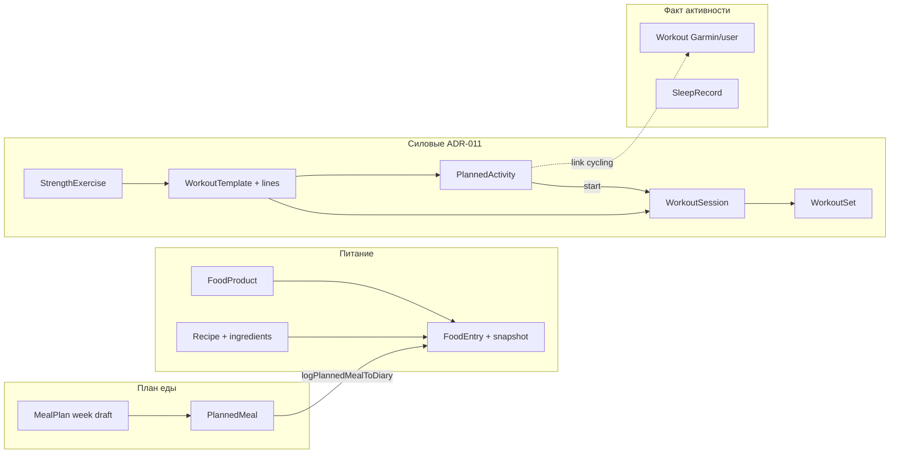
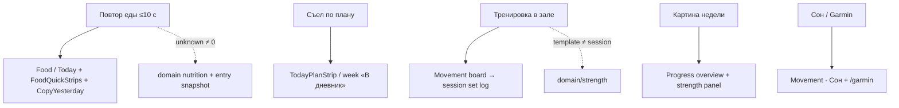
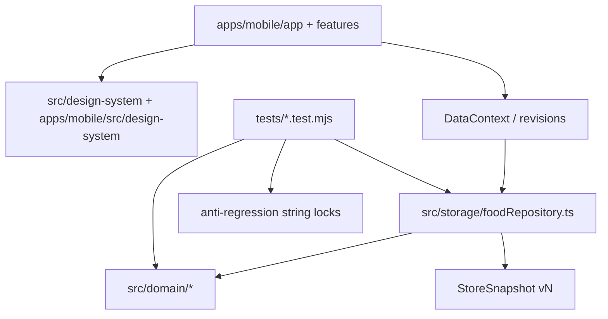
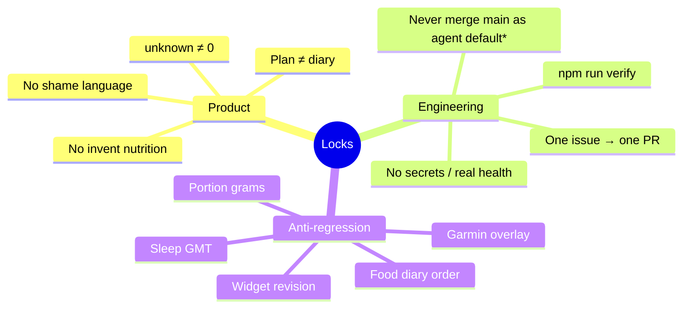

# Agent orientation graphs

**Для агентов:** читать в начале сессии вместе с `AGENTS.md` и `docs/17-DEV-PLAN.md`.  
Цель — не терять карту экранов, домена и запретов. Не заменяет PRD/ADR.

**Живой план / статусы:** `docs/17-DEV-PLAN.md`  
**Силовые:** `docs/23-STRENGTH-MODULE.md`  
**Дыры (закрытые/открытые):** `docs/quality/PRODUCT-GAPS-242.md`  
**Anti-regression:** `docs/quality/ANTI-REGRESSION.md` + `tests/anti-regression-locks.test.mjs`  
**Токены:** `src/design-system/tokens.ts` (cool gray / graphite; без sage chrome)

---

## 1. Tab shell и маршруты

```mermaid
flowchart TB
  subgraph tabs["TAB_SHELL — 5 вкладок"]
    T[Today<br/>app/tabs/index]
    F[Food<br/>app/tabs/food]
    M[Movement<br/>app/tabs/activity]
    P[Progress<br/>app/tabs/progress]
    Pr[Profile<br/>app/tabs/profile]
  end

  T -->|Добавить еду| AddFood[AddFoodSheet / Barcode]
  T -->|План питания| PlanHub[/plan]
  T -->|Тренировка| Sess[/strength/session/id]
  T -->|Привычки| Hab[/progress?segment=habits]
  T -->|TodayPlanStrip| DiaryLog[logPlannedMealToDiary]

  F -->|дневник / каталог| AddFood
  F -->|сегменты| Diary[Diary] & Cat[Catalog]

  M -->|Тренировки| Board[StrengthWeekBoard]
  M -->|Сон| Sleep[SleepDayPanel]
  Board --> Hub[/strength]
  Board --> Sess
  Hub --> Tmpl[/strength/template/id]
  Hub --> Prog[/strength/program]
  M --> Garmin[/garmin]

  PlanHub --> Week[/plan/week]
  PlanHub --> EatNow[/plan/eat-now]
  PlanHub --> Pantry[/plan/pantry]
  PlanHub --> Shop[/plan/shop]
  PlanHub --> Budget[/plan/budget]
  Week -->|В дневник| DiaryLog

  P -->|Неделя / Тело / Привычки / Отчёты| PSeg
  Pr -->|цели Garmin экспорт| Prof

  SleepLegacy["/tabs/sleep"] -.->|redirect| M
```

**Правило IA:** план ≠ дневник ≠ факт сессии. Перенос `PlannedActivity` / `PlannedMeal` не переписывает историю.

---

## 2. Домен: еда / план / сила



**Snapshot:** `STORE_SNAPSHOT_VERSION` в `src/storage/types.ts` (сейчас **v20**).  
**Repo:** почти всё через `FoodRepository` / `createMemoryFoodRepository` — offline-first JSON snapshot + SQLite.

---

## 3. North-star JTBD (куда копать)



---

## 4. Слои кода



| Нужно | Путь |
| --- | --- |
| Экран вкладки | `apps/mobile/app/(tabs)/` |
| Силовые | `apps/mobile/app/strength/` + `features/strength/` |
| План еды | `apps/mobile/app/plan/` + `features/plan/` |
| Дневник / add food | `apps/mobile/src/features/diary/` |
| Домен чисел | `src/domain/` |
| Персист | `src/storage/foodRepository.ts` |
| Виджеты | `src/widgets/` |

---

## 5. Жёсткие запреты (не забывать)



\*Основатель может явно дать merge rights в сессии — иначе только PR.

---

## 6. Быстрый чеклист перед кодом

1. `docs/17-DEV-PLAN.md` — текущий stage / issue  
2. Этот файл — карта экранов/домена  
3. Соотв. slice-doc (`23-STRENGTH`, `20–22` Food Planner, `quality/PRODUCT-GAPS-*`)  
4. Не ломать `tests/anti-regression-locks.test.mjs`  
5. UI: только токены, без локальных hex  

---

## 7. Недавние крупные высадки (контекст 2026-11)

| PR | Суть |
| --- | --- |
| #223 | Movement simplify (день → план → старт) |
| #225–#239 | Codex Fresh Utility + gym/diary/durability stack |
| #240 | Cool gray palette (без sage) |
| #243 | Product gaps: plan→diary, empty CTAs |

Обновляй таблицу при крупных merge, не раздувай changelog.
