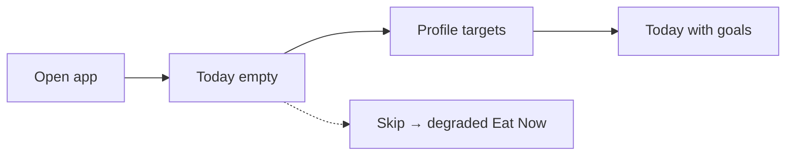
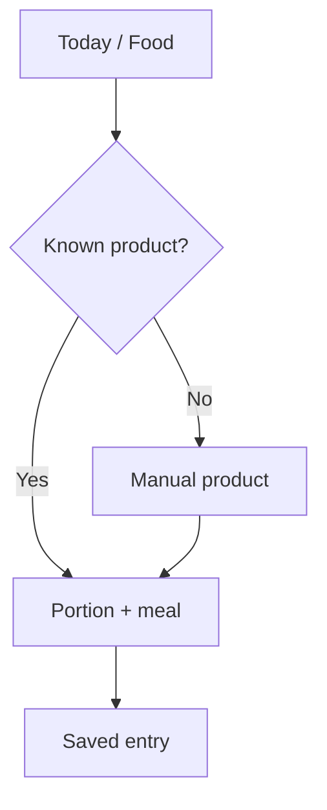
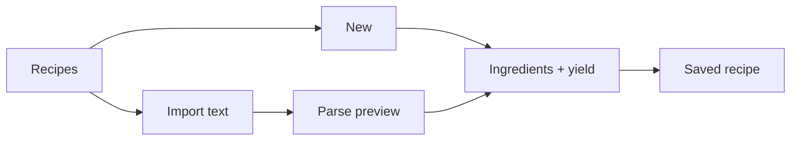
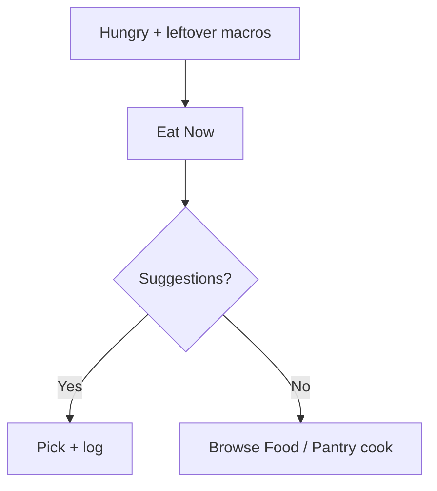
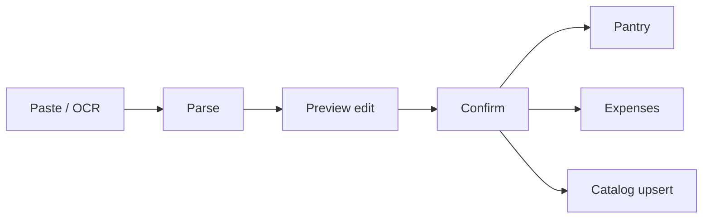

# User Journeys AS-IS / TO-BE — Momentum

**HEAD:** `1da2d0ac` · Audit 2026-10-24  
**Note:** Times are **not measured** on device unless stated. “≤10s” is a product target, not a Pass.

---

## Shared legend

- **FACT** — routes/handlers exist  
- **OBSERVED** — Visual Audit Pack  
- **PROPOSED** — TO-BE suggestions (not roadmap approval)

---

## J01 — First launch & targets

| Field | AS-IS |
|-------|--------|
| Intent | Set daily KBJU so Today/Eat Now make sense |
| Preconditions | Fresh install / empty snapshot |
| Entry | App open → Today or Profile |
| Flow | Open app → notice empty/zero targets → Profile → set kcal/P/F/C → back Today |
| Screens | 2–3 |
| Actions | ~4–6 fields |
| Required data | Targets (at least kcal) |
| Input burden | Medium |
| Success | Today shows goals; Eat Now uses remainder |
| Failures | Skip targets → Eat Now/budget weak |
| Dead ends | Stores/Plan before any food |
| UX issues | No strong onboarding funnel OBSERVED |
| TO-BE (PROPOSED) | One short goals sheet on first open; skip allowed with honest “limited recommendations” |
| Metrics | Time to first targets set; % with targets by day 1 |

---

## J02 — First food log

| Field | AS-IS |
|-------|--------|
| Intent | Log something eaten |
| Entry | Today Quick Add **or** Food tab |
| Flow | Search/catalog → pick → portion → meal → save |
| Screens | 2–4 |
| Success | Diary entry + day totals update |
| Failures | Unknown product; zero search hits |
| TO-BE | Single composer from Today with recent-first |
| Metrics | Time to first food log |

---

## J03 — Repeat habitual breakfast ≤10s

| Field | AS-IS |
|-------|--------|
| Intent | Re-log usual breakfast fast |
| Entry | Today recent / Quick Add |
| Flow | Tap recent → confirm portion/meal → save |
| Screens | 1–2 ideal |
| Success | Entry created |
| Failures | Recent empty; wrong meal slot |
| UX | Duplicate Today/Food paths |
| TO-BE | One-tap re-log with last portion defaults |
| Metrics | Median tap count; **device timing UNVERIFIED** |

---

## J04 — Manual product with KBJU

| Field | AS-IS |
|-------|--------|
| Intent | Add custom food with macros |
| Entry | Food → manual create |
| Flow | Name + P/F/C/kcal + base weight → save → optionally log |
| Required | Name; macros may be partial (unknown≠0) |
| Success | Product in catalog |
| Failures | User invents macros (product forbids agent invent; user can enter) |
| TO-BE | Template presets; clear unknown fields |

---

## J05 — Barcode scan

| Field | AS-IS |
|-------|--------|
| Intent | Identify packaged food |
| Entry | Food barcode action |
| Flow | Camera → lookup → portion → log |
| Status | **Partial** — thin catalog match |
| Failures | No match → manual |
| TO-BE | Match + “save unmatched” with optional later enrich |
| Metrics | Match rate (local only) |

---

## J06 — Create & save recipe

| Field | AS-IS |
|-------|--------|
| Intent | Save homemade dish |
| Entry | Recipes → New **or** Plan hub |
| Flow | Title → ingredients → yield → save |
| Screens | 2–4; long forms OBSERVED |
| Success | Recipe in library with computed nutrition |
| UX | Duplicate create entries |
| TO-BE | Single create entry; progressive disclosure |

---

## J07 — Import recipe from text

| Field | AS-IS |
|-------|--------|
| Intent | Paste blog/chat recipe |
| Entry | `/recipes/import` |
| Flow | Paste → parse → correct → yield → save |
| Burden | Correction rate often high (HYPOTHESIS) |
| Success | Recipe saved |
| TO-BE | Stronger preview + ingredient match chips |

---

## J08 — Cook & log serving

| Field | AS-IS |
|-------|--------|
| Intent | Cook batch, eat portion |
| Entry | Recipe → cook → log serving |
| Flow | Cook → cooked batch → choose serving g → diary |
| Success | Planned≠eaten respected; batch stock updates |
| Failures | Confusion raw vs cooked weight |
| TO-BE | Explicit “raw/cooked” labels everywhere |

---

## J09 — Evening “what should I eat?”

| Field | AS-IS |
|-------|--------|
| Intent | Fit remaining macros |
| Entry | Plan → Eat Now **or** deep link |
| Flow | Open Eat Now → see ranked list → pick → portion → log |
| Preconditions | Targets + some history/pantry help quality |
| Failures | Empty/weak list without data |
| TO-BE | Surface Eat Now from Today when evening + remainder |
| Metrics | Suggestion accept rate (local) |

---

## J10 — Cook from home pantry

| Field | AS-IS |
|-------|--------|
| Intent | Use what I have |
| Entry | Pantry + Eat Now pantry match / Recipes |
| Flow | Maintain pantry → Eat Now filter / recipe match → cook |
| Failures | Stale pantry |
| TO-BE | “Cook from pantry” as first-class Today action |

---

## J11 — Import purchase from order text

| Field | AS-IS |
|-------|--------|
| Intent | Avoid retyping grocery receipt |
| Entry | Plan → Receipt |
| Flow | Paste **or** Screenshot OCR → parse → preview edit → confirm → pantry + expenses + catalog upsert |
| Screens | 3+ |
| OBSERVED | Preview overflow risk |
| OCR | Device UNVERIFIED; web stub |
| TO-BE | Fix overflow; correction UX; retailer templates |
| Metrics | Lines corrected / total; confirm completion |

---

## J12 — Weekly menu

| Field | AS-IS |
|-------|--------|
| Intent | Plan cooks for N days |
| Entry | Plan → Meal plan |
| Flow | Choose horizon → generate/edit → activate |
| OBSERVED | Dense UI |
| TO-BE | Calendar-first; one primary CTA |

---

## J13 — Missing groceries list

| Field | AS-IS |
|-------|--------|
| Intent | Shop only gaps |
| Entry | Shopping from plan |
| Flow | Plan → reconcile pantry → shopping list → check off |
| Failures | Dupes / unit mismatch HYPOTHESIS |
| TO-BE | Merge aliases; pack sizes |

---

## J14 — Monthly food budget

| Field | AS-IS |
|-------|--------|
| Intent | Stay within spend |
| Entry | Budget screen |
| Flow | Set limit → import purchases → view actuals/forecast |
| Failures | Missing prices → opaque forecast OBSERVED |
| TO-BE | Explicit “% priced” completeness meter |

---

## J15 — Log bike / gym

| Field | AS-IS |
|-------|--------|
| Intent | Record workout |
| Entry | Activity tab |
| Flow | Type → duration/distance → save |
| Success | History entry |
| Link to habits | Partial |
| TO-BE | Quick repeat last workout |

---

## J16 — Weight loss progress

| Field | AS-IS |
|-------|--------|
| Intent | See trend |
| Entry | Progress |
| Flow | Log weight → sparkline → history; soft delete mistakes (#86/#87) |
| Success | Trend visible |
| TO-BE | Optional goal weight band (no shame) |

---

## J17 — Habit daily check

| Field | AS-IS |
|-------|--------|
| Intent | Mark habit done |
| Entry | Today habits |
| Flow | Toggle habit → persisted |
| Success | Day check |
| TO-BE | Fewer competing CTAs on Today |

---

## J18 — Export / restore local data

| Field | AS-IS |
|-------|--------|
| Intent | Backup / new phone |
| Entry | Profile export/import |
| Flow | Export snapshot file → later restore |
| Failures | User loses file; version mismatch risk |
| TO-BE | Clear version warning; restore dry-run |

---

## Cross-journey issues (OBSERVED / HYPOTHESIS)

1. Plan hub is a second IA root.  
2. Today vs Food compete for “log food”.  
3. Heavy forms before value (recipe, pantry, plan).  
4. Many flows need prior setup (targets, pantry, prices).

---

## Metrics note

No product telemetry ships. Metrics above are **PROPOSED** local counters only — see `10-ANALYTICS-STRATEGY.md`.
