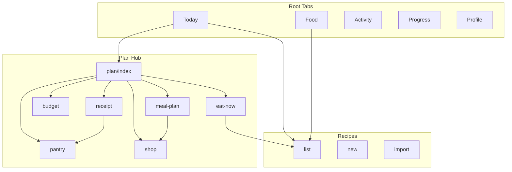

# Information Architecture — Momentum

**HEAD:** `1da2d0ac` · Audit 2026-10-24 · FACT from Expo Router files under `apps/mobile/app/`

---

## Root tabs (FACT)

| Tab | Route group | Primary job |
|-----|-------------|-------------|
| Today | `(tabs)/` Today | Day status, quick log, habits, water |
| Food | Food | Diary + catalog search |
| Activity | Activity | Workouts |
| Progress | Progress | Weight, trends |
| Profile | Profile | Targets, export, settings |

**Plus:** Plan hub and Recipes as nested stacks (`/plan/*`, `/recipes/*`), reachable from Today/Food/Plan entry points — effectively a **sixth product area**.

---

## Nested routes (inventory) — FACT file → URL

`(tabs)` **не** в URL. Root Stack: `(tabs)` | `recipes` | `plan`.

| File | URL |
|------|-----|
| `(tabs)/index` | `/` Сегодня |
| `(tabs)/food` | `/food` |
| `(tabs)/activity` | `/activity` |
| `(tabs)/progress` | `/progress` |
| `(tabs)/profile` | `/profile` |
| `plan/index` | `/plan` |
| `plan/eat-now` | `/plan/eat-now` |
| `plan/pantry` | `/plan/pantry` |
| `plan/week` | `/plan/week` |
| `plan/shop` | `/plan/shop` |
| `plan/budget` | `/plan/budget` |
| `plan/stores` | `/plan/stores` — **не в хабе `/plan`**; вход с `/plan/shop` |
| `plan/receipt` | `/plan/receipt` |
| `recipes/index` | `/recipes` |
| `recipes/new` | `/recipes/new` |
| `recipes/import-text` | `/recipes/import-text` |
| `recipes/import-personal` | `/recipes/import-personal` |
| `recipes/[id]` | `/recipes/:id` |
| `recipes/edit/[id]` | `/recipes/edit/:id` |

**~20 screen routes** (+ `+not-found`). Route-based modal screens **нет**.

### Overlays (local `visible` state, not routes)

| Sheet/modal | Mount points (examples) |
|-------------|-------------------------|
| `AddFoodSheet` | Today, Food |
| `ConfirmPortionSheet` | Today, Food, Eat Now, recipe detail, nested in AddFood/Barcode |
| `BarcodeLookupSheet` → optional `LabelCaptureSheet` | Today, Food, nested AddFood |
| `DayCalendarSheet` | Today, Food, Activity |
| `WorkoutFormSheet` | Activity |
| `RecookRecipeSheet` | Recipe detail |
| `SaveMealModal` / `PortionEditModal` | Food |
| Profile paste `Modal` | Profile import |

`JourneyShortcuts` component exists but **is not imported on screens** (removed from Today fold).

---

## Navigation graph (simplified)

---

## Depth

| Area | Typical depth | Risk |
|------|---------------|------|
| Quick re-log | 1–2 | OK |
| Purchase import | 3–4 | Drop-off |
| Week plan edit | 3–5 | Cognitive overload OBSERVED |
| Recipe create | 2–4 | Long forms |

---

## Repeated entry points (FACT / OBSERVED)

- Log food: Today Quick Add **and** Food tab  
- Create recipe: Recipes new **and** import **and** Plan links  
- “What to eat”: Eat Now vs browsing Food vs pantry cook  

---

## Dead ends / weak ends

| Screen | Issue |
|--------|-------|
| Stores | Tags only; no live catalog → feels empty |
| Budget without expenses | Opaque zeros |
| Eat Now without targets/pantry | Weak list |
| Shopping without plan | Manual-only burden |

---

## Answers to required IA questions

### 1. Why open Today instead of Food?

**Today** is the **day cockpit** (totals, habits, water, planned, quick repeat). **Food** is the **library + structured diary**. Users who only want search may prefer Food; product north-star favors Today for speed. Overlap is a confirmed IA tension.

### 2. Where search product vs recipe?

- **Products:** Food tab search / catalog.  
- **Recipes:** Recipes stack search.  
- Eat Now mixes both conceptually (scored items). Risk: users look in wrong place.

### 3. Where is “what to cook?”

Primarily **`/plan/eat-now`**, secondarily Recipes + Pantry. Not on root tabs — **discoverability risk**.

### 4. Where is weekly menu?

**Plan → meal plan** (not a root tab).

### 5. Where are purchases managed?

**Plan → shopping** (list) and **Plan → receipt** (import). Expenses surface in **budget**. Fragmented.

### 6. Why is Stores its own screen?

Historically for retailer preference / future catalogs. **Today:** thin tags; live ingest blocked. **PROPOSED:** demote to Profile preference or hide until BD catalogs exist.

### 7. What to merge? (PROPOSED only)

- Today quick-log + Food diary composer  
- Shopping + receipt “after shop”  
- Recipe new/import into one create funnel  

### 8. What to hide? (PROPOSED)

- Stores (until catalogs)  
- Challenges (if low engagement — UNVERIFIED)  
- Dense plan generator knobs behind “Advanced”

### 9. Contextual actions vs pages (PROPOSED)

- Re-log, water, habit toggle → stay contextual on Today  
- “Add missing to shopping” from recipe/plan row  
- Soft-delete weight from Progress row  

### 10. Competing intents

| Intent | Competing surfaces |
|--------|-------------------|
| Log food now | Today / Food / Eat Now / Recipe cook |
| Use leftovers | Pantry / Eat Now / Recipes |
| Control spend | Budget / Shopping / Receipt |
| Plan week | Meal plan / shopping / recipes |

---

## Non-goals of this doc

No navigation rewrite. Changes require founder decision (`12-FOUNDER-DECISIONS.md`).
