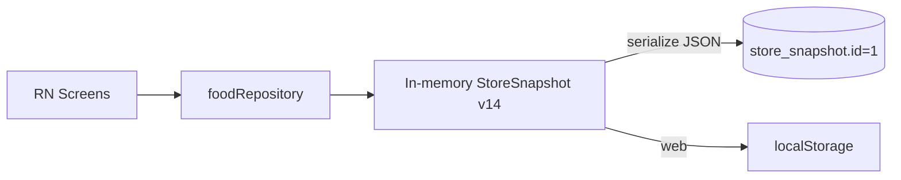
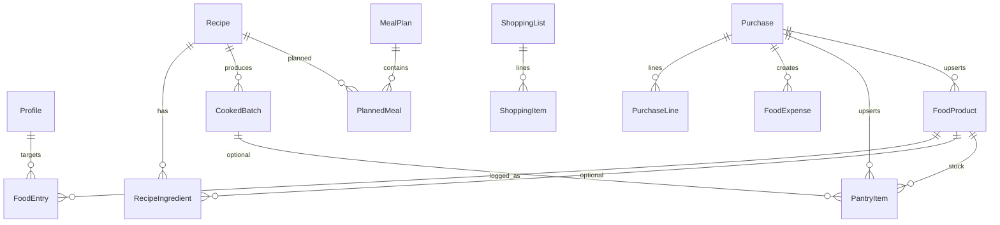

# Data Model — Momentum

**HEAD:** `1da2d0ac` · **StoreSnapshot.version = 14** (`src/storage/types.ts`)  
**SQL schema:** `SCHEMA_VERSION = 1` — single table `store_snapshot` payload JSON (`src/storage/migrations.ts`)  
**Repository:** `src/storage/foodRepository.ts` (~3334 LOC)

---

## Persistence model (FACT)

- Every mutation updates memory then persists **full snapshot**.
- Soft deletes via `deletedAt` on many entities.
- Snapshot migrations: load `StoreSnapshotAny` versions **1…14**, normalize to v14 in repository (not SQL alter).

---

## Entity catalog

### Profile

| Field | Notes |
|-------|-------|
| id, timezone, locale, units | Singleton-ish |
| waterTargetMl | null = hidden |
| heightCm | BMI optional |
| dailyEnergyKcal / Protein/Fat/Carb | **null ≠ 0**; user-set only |
| dogfoodStartedOn | Gate helper |

**Lifecycle:** created with store; edited in Profile. No delete.

### FoodProduct

id, name, brand?, barcode?, energy/protein/fat/carb **nullable**, source (`user|label|catalog|recipe|missing`), favorite, timestamps, deletedAt.

**Creates:** manual, seed catalog (~198), purchase upsert (#81/#82), OFF integration path.  
**Invariant:** unknown macros stay null.

### Recipe + RecipeIngredient

Recipe: name, cookedYieldG, description/instructions/photo optional, **optional finished per-100g nutrition**.  
Ingredient: productId?, displayName, rawGrams, macros nullable.

**Invariant:** diary may prefer finished per-100g when set (#72); else ingredient math (`recipeNutrition.ts`).  
**Risk:** UI showing different KBJU if one path uses Atwater and another label — partially fixed.

### FoodEntry (diary)

dateLocal, meal slot, productId?/recipeId?, displayName, grams, **nutrition snapshot at log time**, source, soft delete.

**Invariant:** **Planned ≠ eaten** — planned meals are separate (`PlannedMeal`).

### WaterEntry / WeightEntry / Workout / HabitCheck / FlexibleHabit*

Standard logs; weight supports soft delete (#86/#87).

### SavedMeal

Templates for quick repeat (`repeatMeal` domain).

### Challenge

Secondary gamification-adjacent; status active/completed/abandoned. Product caution: no shame.

### PantryItem

product link, qty, unit `g|ml|pcs`, location fridge/freezer/pantry, source user|purchase, uncertain qty support in model.

### CookedBatch

Cooked yield stock from recipes; consume when logging servings.

### MealPlan + PlannedMeal

Plan status draft/active/archived; meals planned|logged|skipped; diversity knobs.

### ShoppingList + ShoppingItem

open/done/archived; price source user|receipt|estimate; reconcile with pantry/purchase (`shoppingReconcile.ts`).

### ProductPrice / FoodBudget / FoodExpense

Budget monthly limit; expenses from purchase confirm; categories groceries/cafe/office/delivery.

### Purchase + PurchaseLine

status pipeline; sourceKind `manual|paste|photo|screenshots|qr`; lines with qty/unit/price; confirm → pantry + expenses + catalog (`purchaseConfirm.ts`).

### StorePreference

Tag preferences only — **not** live catalog rows.

---

## Relationship diagram

---

## Critical invariants (FACT / policy)

| Invariant | Evidence |
|-----------|----------|
| `null` nutrition ≠ `0` | `nutrition.ts`, validation, AGENTS.md |
| Entry stores snapshot macros | `FoodEntry` fields |
| Planned ≠ eaten | `PlannedMeal` vs `FoodEntry` |
| Raw vs cooked | `rawGrams` vs `cookedYieldG` / batch |
| Soft delete preferred | `deletedAt` |
| No invented agent macros | AGENTS / product rules |
| Purchase confirm idempotency | Domain helpers — re-import dupe risk if user confirms twice **HYPOTHESIS** partial mitigations |

---

## Validation

`src/storage/validation.ts` + repository guards (`addGuard.ts`). Agents must not bypass.

---

## Scale risks (HYPOTHESIS — not measured on device)

| Scale | Snapshot size (Node bench) | Risk |
|-------|----------------------------|------|
| ~100 entries | ~65 KB | Low |
| ~1k | ~433 KB | Serialize ms low on Node |
| ~10k | ~3.8 MB | Full rewrite each mutation; UI jank **unverified** |
| 50k | Extrapolate | Likely need relational split / incremental persist |

Search P95 Node D10k ~11ms — **does not** prove FlatList jank.

---

## Data loss scenarios

1. User clears app data / uninstall without export.  
2. Failed restore of newer snapshot on older app (version mismatch).  
3. Web localStorage quota (web dogfood only).  
4. Partial write crash — SQLite single-row replace; durability **UNVERIFIED** pending #36.

---

## Conversions & matching

- Units g/ml/pcs: pantry + purchase lines; conversion edge cases in reconcile.  
- Aliases: `matchPurchaseProduct.ts` — imperfect → shopping dupes HYPOTHESIS.  
- Prices incomplete → budget forecast honesty issues.
