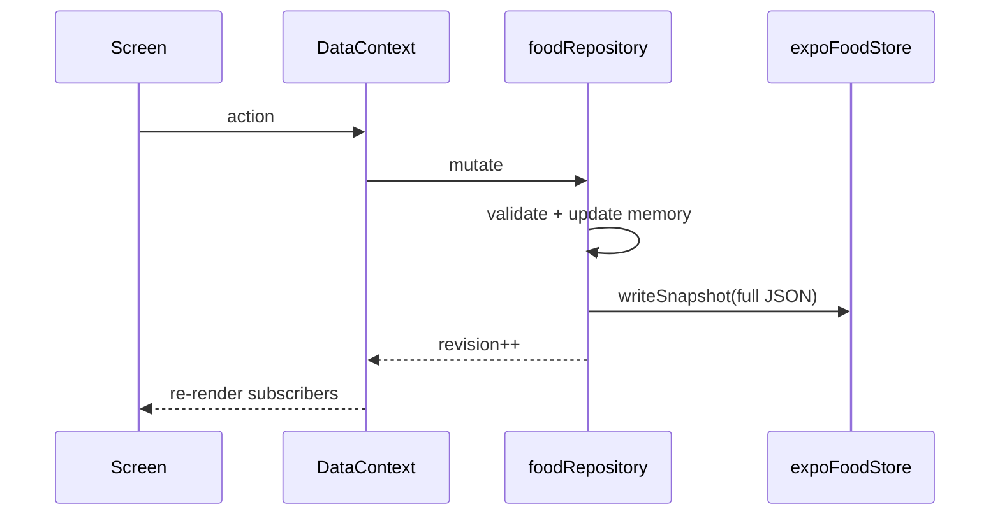

# Technical Architecture — Momentum

**HEAD:** `1da2d0ac` · Audit 2026-10-24

---

## Stack (FACT)

| Layer | Choice |
|-------|--------|
| App | Expo + React Native + Expo Router |
| Language | Strict TypeScript |
| State | `DataContext` + `foodRepository` in-memory + revision bump |
| Persist | SQLite full JSON snapshot (native); localStorage (web) |
| Domain | Pure modules under `src/domain/*` (42 files) |
| Tests | Node `tests/*.mjs` (~45 files) via `npm run verify` |
| OCR | On-device ExecuTorch OCR_RUSSIAN (#84/#85); web stub |
| CI | GitHub Actions; Cloud Agents / Dispatcher **off** by default |

Monorepo-ish: root `src/` shared domain+storage; `apps/mobile` UI.

---

## Component structure

```
apps/mobile/app/          # Expo Router routes (~25 files)
apps/mobile/src/
  components/             # shared UI (~26 tsx)
  features/               # diary, recipes, plan, habits, …
  state/                  # DataContext
  storage/                # expoFoodStore(.native)
  ocr/                    # on-device adapter
src/domain/               # pure logic
src/storage/              # foodRepository, types, migrations, validation
src/integrations/         # barcode, Open Food Facts helpers
```

---

## State & data flow



**Risk FACT:** global revision can over-notify. Full snapshot write each time.

---

## Routing map (FACT)

**Tabs:** `index` (Today), `food`, `activity`, `progress`, `profile`  
**Plan:** `plan/index`, `eat-now`, `pantry`, `shop`, `budget`, `receipt`, `stores`, `week`  
**Recipes:** `index`, `new`, `[id]`, `edit/[id]`, `import-text`, `import-personal`

---

## Integrations

| Integration | Status | Evidence |
|-------------|--------|----------|
| Open Food Facts | Helper present; not primary offline path | `src/integrations/openFoodFacts.ts` |
| Barcode normalize | Present | `barcodeNormalize.ts` |
| Retailer scrape METRO/Samokat/Lavka | **Blocked** / throws | `storeCatalogAdapter.ts`, FI docs |
| VkusVill MCP | Reference only | docs |
| ExecuTorch OCR | Shipped native; accuracy UNVERIFIED | `apps/mobile/src/ocr` |
| Cloud OCR / analytics SDK | Not shipped | policy |

---

## Snapshot evolution

- SQL: v1 only (payload blob).  
- JSON StoreSnapshot: v1→v14 additive fields; loader accepts `StoreSnapshotAny`.

---

## God objects & hotspots

| Symbol | Size/role | Risk |
|--------|-----------|------|
| `foodRepository.ts` | ~3334 LOC | Regression cost; mixed concerns |
| `types.ts` StoreSnapshot | Wide aggregate | Evolve carefully |
| Plan hub screens | Many features | IA + bundle |

---

## Security / privacy

- No secrets in repo (AGENTS).  
- Synthetic fixtures only.  
- Export is local file — user responsibility.  
- OCR model download may need network first run — **not** cloud inference of receipts (on-device).

---

## Automation

- `.github/` workflows + `automation/` prompts.  
- `DISPATCH_ENABLED=false` — do not enable in this audit.  
- Dogfood APK meta: `docs/quality/apk/DOGFOOD-APK.md`.

---

## External deps (high level)

Expo SDK, React Navigation via Expo Router, expo-sqlite, ExecuTorch OCR deps (native APK size ~200MB+). Exact lockfile: `package-lock.json` / `apps/mobile` package.

---

## What docs claim vs code

| Claim | Reality |
|-------|---------|
| Offline-first diary | FACT |
| Live store catalogs | Docs aspirational; code blocked |
| Android Pass | Docs explicitly not claimed |
| ≤10s repeat | Target; not measured |
