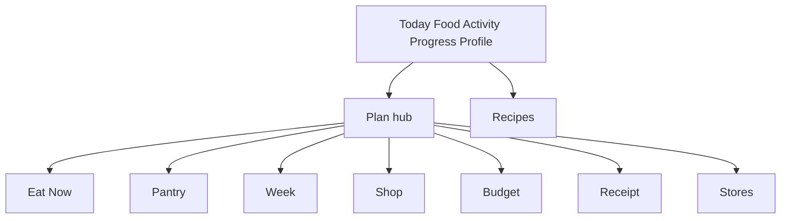
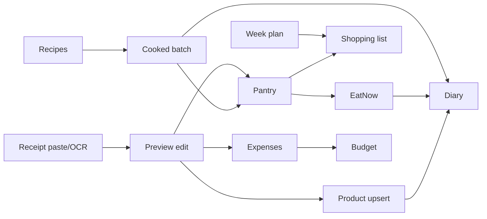

# ChatGPT Handoff — Momentum Product Intelligence

**Self-contained brief for an external AI consultant without repo access.**  
**Audit HEAD:** `1da2d0acb3c15bf68a9d009d19758d68406ce979` (2026-10-24, merge #88 dogfood APK meta)  
**Schema:** StoreSnapshot **v14** · SQLite SQL schema **v1** (JSON blob)  
**Evidence labels:** FACT · OBSERVED · HYPOTHESIS · UNVERIFIED · PROPOSED  

Companion files in this folder: `00`–`13`. Prefer citing them rather than inventing.

---

## 1. What Momentum is

Momentum is an **offline-first Android** nutrition / habits / fitness app (Expo React Native + TypeScript).  

**North-star:** log habitual meals in **≤10 seconds**, preserve privacy (local data), never shame the user, never invent nutrition values, treat **unknown macros as null (not zero)**, and keep **planned meals ≠ eaten diary entries**.

There is **no backend** for the current vertical slice. Persistence is an in-memory domain store serialized as one JSON **StoreSnapshot** into SQLite (`store_snapshot` table).

Target user (dogfood): founder / early user who cooks, shops (RU retailers: Samokat, METRO, etc. as paste/OCR sources), tracks KBJU, optionally budget and habits.

---

## 2. Problems it tries to solve (JTBD)

1. Fast repeated food logging  
2. “What should I eat now?” given remaining macros + pantry  
3. Real recipes with yield / cooked batches  
4. Import groceries from order text / screenshots without retyping  
5. Week meal planning → shopping list → pantry → diary loop  
6. Monthly food budget awareness  
7. Light activity, habits, weight progress  

---

## 3. Navigation (AS-IS)

**Root tabs:** Today · Food · Activity · Progress · Profile  

**Secondary roots:**  
- `/plan/*` hub — Eat Now, Pantry, Week menu, Shopping, Budget, Receipt import, Stores  
- `/recipes/*` — library, new, import-text, import-personal, detail, edit  

**IA tension (OBSERVED/FACT):** Today and Food both serve “log food”; Plan feels like a second app; Stores is nearly empty without live catalogs.

Full map: [`03-INFORMATION-ARCHITECTURE.md`](./03-INFORMATION-ARCHITECTURE.md).

---

## 4. What is implemented (FACT highlights)

| Area | Status | Notes |
|------|--------|-------|
| Diary + catalog search + manual product | Working | Seed ~198 products; user products |
| Quick/recent re-log | Working | ≤10s **not measured** on device |
| Recipes create/import/cook/log | Working | Multiple create entries |
| Pantry + purchase confirm→stock | Working | #81/#82 catalog upsert |
| Eat Now scorer | Working | Quality data-dependent |
| Week plan + shopping reconcile | Working | Dense UX |
| Budget + expenses from purchases | Partial | Incomplete prices |
| Screenshot OCR→parse→preview | Partial | On-device ExecuTorch RU; device accuracy UNVERIFIED; web stub |
| Barcode | Partial | Thin DB |
| Stores live catalogs | Blocked | Adapter throws; needs BD — no scrape |
| Weight soft-delete + sparkline | Working | #86/#87 |
| Habits / workouts / challenges | Working/Partial | Secondary |
| Export/restore snapshot | Working | User file care |
| Cloud sync / telemetry | Not present | By design |

Full catalog: [`01-FEATURE-INVENTORY.md`](./01-FEATURE-INVENTORY.md).

---

## 5. How features connect

**Closed loop aspirational moat:** Plan → Shop → Purchase import → Pantry → Eat Now / Cook → Diary → Budget.

---

## 6. User scenarios (18)

Documented AS-IS/TO-BE in [`02-USER-JOURNEYS.md`](./02-USER-JOURNEYS.md): first goals, first log, ≤10s repeat, manual product, barcode, recipe create/import, cook+log, Eat Now, pantry cook, purchase import, week menu, shopping gaps, budget, workout, weight progress, habits, export/restore.

**Do not invent timings** — device Pass open (#36–#38).

---

## 7. What hurts or is incomplete

| Theme | Class | Detail |
|-------|-------|--------|
| Android unproven | FACT | No kill-app / ≤10s / Maestro Pass |
| IA overload | OBSERVED | Today/Food/Plan/Stores |
| Pantry form-dominant | OBSERVED | Visual pack |
| Week density | OBSERVED | Partial fix #77 |
| Eat Now value | HYPOTHESIS | Weak without data |
| Budget opacity | OBSERVED | Partial #74 |
| Recipe KBJU inconsistency | Partial fix #72 | Monitor |
| Purchase preview overflow | Fixed web #72/#75 | Android UNVERIFIED |
| Retail prices/catalogs | External block | |
| OCR quality | UNVERIFIED | |
| Full-snapshot scale | Node measured; device HYPOTHESIS | D10k ~3.8MB |

Screen audit: [`04-SCREEN-BY-SCREEN-AUDIT.md`](./04-SCREEN-BY-SCREEN-AUDIT.md).  
Register: [`11-ISSUE-REGISTER.md`](./11-ISSUE-REGISTER.md).

---

## 8. Data model (essentials)

Single aggregate **StoreSnapshot v14** includes: profile/targets, products, recipes+ingredients, diary entries, water, weight, habits, workouts, challenges, pantry, cooked batches, meal plans, shopping, prices, budgets, expenses, store prefs, purchases+lines.

**Invariants:** null≠0 · planned≠eaten · entry nutrition snapshot · soft deletes · raw vs cooked weights.

SQL only stores one payload row (schema v1). Snapshot versions 1…14 accepted on load.

Details: [`05-DATA-MODEL.md`](./05-DATA-MODEL.md).

---

## 9. Hard constraints (do not violate)

1. No invented nutrition by agents  
2. No real health/receipt PII in tests/docs  
3. No retailer scrape without BD/legal  
4. No production Play/EAS / secret rotation by agents  
5. No Dispatcher auto-merge while quality gates open  
6. Unknown macros must stay unknown  
7. Shame / under-eating gamification forbidden  
8. Dangerous migrations need human approval  

---

## 10. UX problems (top)

1. Duplicate log surfaces (Today vs Food)  
2. Plan hub as second home  
3. Pantry UX form-first  
4. Weak/empty Eat Now without setup  
5. Budget looks precise when prices missing  
6. Multiple recipe creation doors  
7. Stores screen without catalogs  
8. Dense week planner  

Visual evidence: 47 Expo **web** PNGs (`docs/quality/visual-audit-pack/`) — **not** Android Pass.

---

## 11. Technical risks (confirmed vs hypo)

| Risk | Status |
|------|--------|
| `foodRepository` ~3334 LOC god object | FACT size; quality impact mixed |
| Full JSON persist each mutation | FACT; device jank HYPOTHESIS |
| Global DataContext revision | FACT pattern |
| Non-virtualized lists | Suspected FACT |
| OCR APK size ~200MB+ | FACT dogfood meta |
| Android durability | UNVERIFIED (#36) |

See [`06-TECHNICAL-ARCHITECTURE.md`](./06-TECHNICAL-ARCHITECTURE.md), [`07-PERFORMANCE-AND-RELIABILITY.md`](./07-PERFORMANCE-AND-RELIABILITY.md).

---

## 12. Open questions

1. D1 focus: diary speed vs full FI suite?  
2. Approve IA merge/hide Stores?  
3. Retail partner strategy?  
4. OCR: moat or experimental?  
5. Any telemetry ever?  
6. When is “good enough” for Play?  

Workshop sheet: [`12-FOUNDER-DECISIONS.md`](./12-FOUNDER-DECISIONS.md).

---

## 13. Product decisions needing discussion

- Hide/defer Challenges, Stores  
- Unify Today/Food  
- Budget honesty threshold  
- Whether to market OCR  
- Persist architecture investment timing  

Draft priority bands (unapproved): [`13-RECOMMENDED-PRIORITIES.md`](./13-RECOMMENDED-PRIORITIES.md) — **Band 0 = Android proof first**.

---

## 14. Potentially highest-value directions (PROPOSED)

1. **Prove Android dogfood Pass** before big bets  
2. **Protect ≤10s diary** path (IA + one-tap recent)  
3. **Trust the FI loop** (pantry UX, purchase quality, budget honesty, Eat Now entry)  
4. **Privacy OCR** as differentiator only after accuracy evidence  
5. **Do not** build scrape catalogs without BD  

Gaps analysis: [`09-PRODUCT-GAPS.md`](./09-PRODUCT-GAPS.md).  
Analytics (local-only plan): [`10-ANALYTICS-STRATEGY.md`](./10-ANALYTICS-STRATEGY.md).

---

## 15. Counts from this audit

| Item | Count |
|------|-------|
| Route/screen files (tabs+plan+recipes) | ~20 URLs; 25 app files incl. layouts |
| Domain modules `src/domain/*.ts` | 42 |
| Overlays | Sheets/modals via local state (not route modals) |
| Test suites `tests/*.mjs` | 44 + 1 helper |
| Visual audit PNGs | 47 (+ after/ subset) |
| Capability rows inventoried | 90+ |
| Journeys mapped | 18 |
| Open GH quality gates | #36 #37 #38 (+ tokens #52/#55) |

---

## 16. Unverified areas (explicit)

- Physical Android UI / safe area / keyboard  
- Repeat meal wall-clock ≤10s  
- Kill-app durability  
- Maestro E2E Pass  
- OCR accuracy on real retailer screenshots  
- TalkBack a11y  
- Real-user analytics (none)  
- FlatList jank on device  
- Shopping duplicate frequency in wild  

---

## 17. How to use this pack

1. Read Executive Summary [`00-EXECUTIVE-SUMMARY.md`](./00-EXECUTIVE-SUMMARY.md)  
2. Use this handoff as **AS-IS audit** context  
3. Forward plan is now locked in [`15-MOMENTUM-2.0-VISION-AND-ROADMAP.md`](./15-MOMENTUM-2.0-VISION-AND-ROADMAP.md)  
4. IA target [`16`](./16-TARGET-IA.md) · Phase 0–1 AC [`17`](./17-PHASE-0-1-ACCEPTANCE.md) · decisions [`12`](./12-FOUNDER-DECISIONS.md)  
5. File GitHub issues from Phase 0–1 batch only; do not auto-implement entire roadmap  

**Audit stage complete. Strategy approved. Execution = one issue at a time from first batch.**
