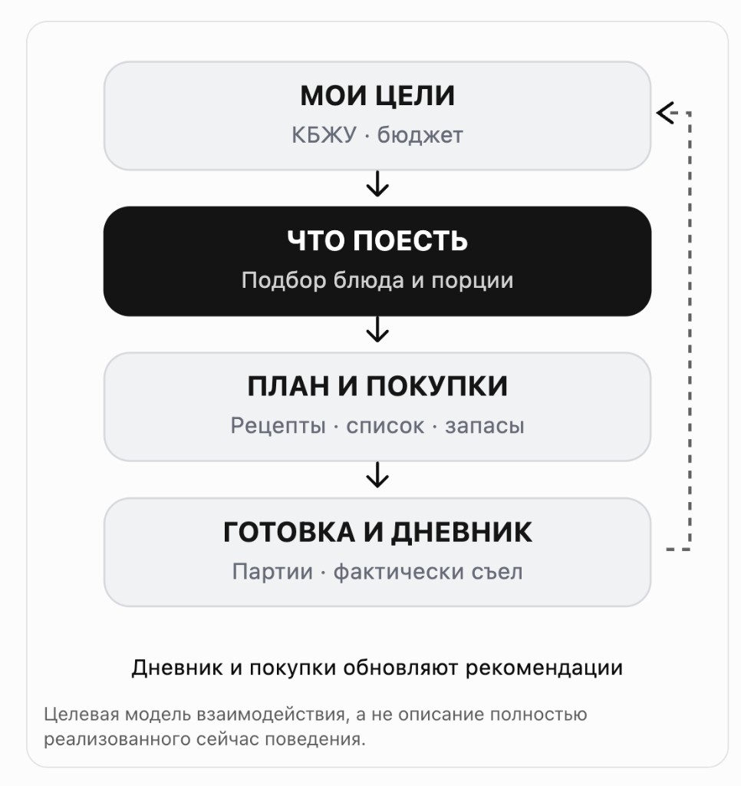
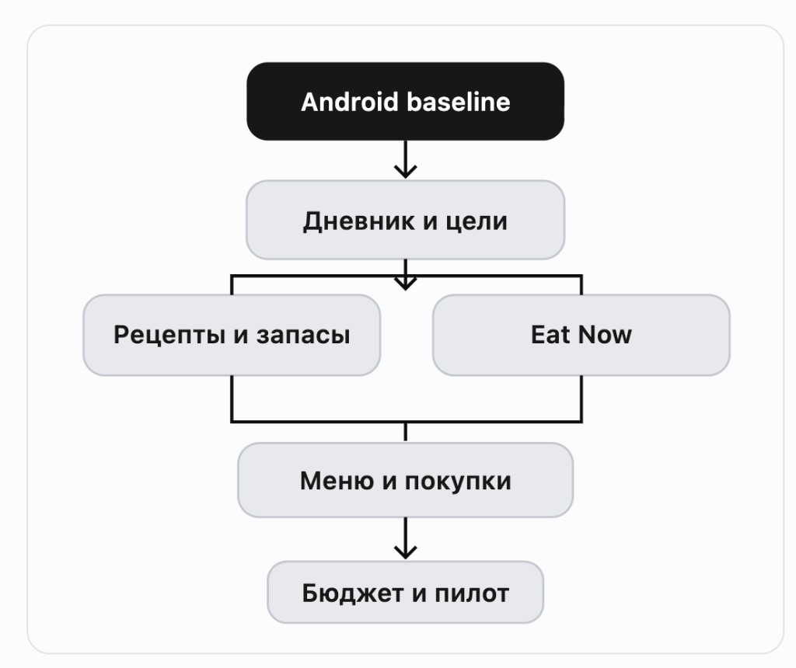

# Momentum 2.0 — Product Vision & Roadmap

| Field | Value |
|-------|--------|
| **Status** | **Approved strategy document** (founder + ChatGPT, 2026-10-24) |
| **Horizon** | 12 weeks (orientational — not a guaranteed calendar) |
| **Strategy** | Food Intelligence |
| **Audit base** | HEAD `1da2d0ac` · pack `00`–`14` |
| **Next exec step** | Lock target IA + Phase 0–1 acceptance → [`16`](./16-TARGET-IA.md), [`17`](./17-PHASE-0-1-ACCEPTANCE.md) |

**Label:** PROPOSED UI/IA below is **target**, not current AS-IS. Current AS-IS remains in `03`, `01`, `14`.

---

## Product Vision

**Momentum — от вопроса «Что поесть?» до готового решения.**

Приложение помогает питаться по целям, использовать продукты дома, планировать готовку и контролировать расходы — без постоянных расчётов и повторного ввода.

| Pillar | Meaning |
|--------|---------|
| Экономит время | Меньше поиска и ввода |
| Помогает выбрать | Еда под реальные условия |
| Контролирует бюджет | Покупки и расходы вместе |

**Не делаем:** ещё один FatSecret/MFP · очередной сборник рецептов · конкуренцию доставкам «в лоб».

**Преимущество:** Momentum знает, что пользователь ест, что есть дома, что готовит, чего не хватает и сколько это стоит.

### Audience

Готовит дома, держит КБЖУ, регулярно покупает продукты, хочет меньше времени на организацию питания (снижение веса / спорт / просто рацион без ежедневного «что приготовить?»).

### Product principles

1. Решение важнее функции (блюдо, список, запись).  
2. Меньше ввода — одни данные во многих сценариях.  
3. Никаких вымышленных КБЖУ, цен, остатков, достижений.  
4. Offline-first без обязательного аккаунта.  
5. Планирование ≠ фактическое потребление.  
6. Никакого давления / штрафов / оценки за отклонения.  
7. AI/автоматизация только если уменьшают работу и допускают проверку.

Сохраняет ядро и ограничения из `AGENTS.md` / аудита. См. [`14-CHATGPT-HANDOFF.md`](./14-CHATGPT-HANDOFF.md).

---

## Главная продуктовая модель

Целевой цикл (не полное текущее поведение):



1. **Мои цели** — КБЖУ · бюджет  
2. **Что поесть** — подбор блюда и порции (**ядро решения**)  
3. **План и покупки** — рецепты · список · запасы  
4. **Готовка и дневник** — партии · фактически съел → обратно к целям  

*Дневник и покупки обновляют рекомендации.*

Уже есть звенья: покупка→запасы, рецепты→партии, план→покупки, Eat Now→дневник. Нужны **склейки разрывов**, не rewrite. См. [`05-DATA-MODEL.md`](./05-DATA-MODEL.md).

---

## Целевая информационная архитектура

AS-IS: 5 tabs + вложенные Plan/Recipes → «несколько приложений». [`03-INFORMATION-ARCHITECTURE.md`](./03-INFORMATION-ARCHITECTURE.md).

**Target tabs:**


| Вкладка | Задача | Содержимое |
|---------|--------|------------|
| Сегодня | Что важно сейчас? | КБЖУ, быстрый лог, следующая еда, краткий план, привычки |
| Питание | Что съел / что записать? | Дневник, каталог, поиск, избранное, **рецепты** |
| **План** | Что приготовить и купить? | Eat Now, запасы, неделя, покупки, бюджет |
| Прогресс | Как меняются результаты? | Вес, питание, **тренировки**, привычки, графики |
| Профиль | Настройки | Цели, экспорт, приватность, источники |

- Заменяем tab **Активность** → **План**.  
- Активность **не удаляем**: доступ из Прогресса + быстрые действия; regress navigation.  
- Шестую вкладку **не** добавляем.  
- Детальная спецификация: [`16-TARGET-IA.md`](./16-TARGET-IA.md).

---

## Ключевые экраны (направление)

Референсы / mockups — **не** pixel-copy; сохранить монохромный язык Momentum.

| Экран | Направление |
|-------|-------------|
| Сегодня | Командный центр: остаток КБЖУ, одно primary CTA, next meal |
| Что съесть | 3–5 вариантов: граммы, КБЖУ, время, наличие, «из дома» / быстро / купить |
| План / неделя | Calendar-first; генератор — secondary |
| Покупки + запасы | Одна предметная область; импорт с подтверждением; без вымышленных цен |

Assets: `assets/mockups-set-a.jpg`, `mockups-set-b.jpg`, `plan-day-reference.png`.

---

## 12-недельный roadmap



```
Android baseline → Дневник и цели → (Рецепты/запасы ‖ Eat Now) → Меню и покупки → Бюджет и пилот
```

| Weeks | Focus |
|-------|--------|
| 1–2 | Phase 0 — Надёжность |
| 3–4 | Phase 1 — Единый ежедневный опыт / навигация |
| 5–6 | Phase 2 — Eat Now 2.0 |
| 7–8 | Phase 3 — Рецепты и запасы 2.0 |
| 9–10 | Phase 4 — Меню и покупки |
| 11–12 | Phase 5 — Финансы, качество, пилот |

Quality fixes continuous. Android gate **не** блокирует параллельный design/docs; **блокирует** claim Pass / feature «done» без device где требуется.

### Phase 0 — Q-01…Q-06

| ID | Task | Acceptance (short) |
|----|------|--------------------|
| Q-01 | #36 force-stop persist | 20 циклов без потери |
| Q-02 | #37 repeat ≤10s | ≥20 замеров, медиана ≤10s, device+build |
| Q-03 | #38 Android smoke | Critical E2E on device |
| Q-04 | Preview overflow regress | No H-overflow @ 320/360/390 |
| Q-05 | Recipe KBJU consistency | One policy all UI paths |
| Q-06 | OCR real screenshots | Labeled set + metrics; no false «100%» |

Detail: [`17-PHASE-0-1-ACCEPTANCE.md`](./17-PHASE-0-1-ACCEPTANCE.md). Evidence base: [`07-PERFORMANCE-AND-RELIABILITY.md`](./07-PERFORMANCE-AND-RELIABILITY.md).

### Phase 1 — UX-01…UX-05, QA-07

Единый add-food · упростить Today · first-run goals · tab План · contextual re-log · nav regression.

### Phase 2 — FI-01…FI-06, QA-08 (главный FI)

Portion-aware · explain · fallback без целей · из запасов · evening snack · direct actions · correctness matrix. Builds on `scoreEatNow` ([`01-FEATURE-INVENTORY.md`](./01-FEATURE-INVENTORY.md)).

### Phase 3 — FI-07…FI-12

List-first pantry · one recipe create · stock edit · cooked batches · raw/cooked labels · import field editor.

### Phase 4 — FI-13…FI-18, QA-09

Calendar-first week · card actions · independent shop · missing from menu · merge suggest (confirm) · purchase idempotent confirm · E2E FI chain.

### Phase 5 — FI-19…FI-21, QA-10…QA-12

Budget completeness · clear budget view · demote Stores · full Android matrix · perf large data · 7–14d real use → **closed pilot candidate**, not auto Play.

---

## Work categories (for Cursor)

| Category | Rule |
|----------|------|
| Bugs | Fix + regression test |
| UX | Whole scenarios, not style-only |
| New capability | Only with proven user scenario |
| Architecture | By measurements, not LOC |
| Quality | Mandatory each phase |
| Research | Before build (retail, OCR position) |

Aligns with [`11-ISSUE-REGISTER.md`](./11-ISSUE-REGISTER.md).

---

## Architecture: do / don't

**No full rewrite.** Clearer subsystem boundaries:

UI (Today · Food · Plan · Progress · Profile) → Food Log / Intelligence / Planning → Domain & Repository → Local SQLite (v14 today; evolve later).

| ID | When |
|----|------|
| ARCH-01 | Measure SQLite write latency — Ph 0/5 |
| ARCH-02 | Selective subscriptions — after profile proof |
| ARCH-03 | List virtualization — on jank proof |
| ARCH-04 | Split foodRepository — incremental with features |
| ARCH-05 | Incremental SQLite spike — after proven pain |
| ARCH-06 | OCR/APK size — after OCR device tests |

**Out of 12 weeks:** mandatory backend, accounts, cloud sync, AI coaching, extra tabs, retailer scrape. Catalogs = research track ([`06`](./06-TECHNICAL-ARCHITECTURE.md)).

---

## Success metrics (targets, not achieved)

Local-only first ([`10-ANALYTICS-STRATEGY.md`](./10-ANALYTICS-STRATEGY.md)):

| Metric | Target orient |
|--------|----------------|
| Repeat habitual meal | median ≤10s |
| First food log | unaided completion |
| Eat Now → pick | ≤30s in test task |
| Recipe → cook → portion | no re-enter recipe |
| Purchase import | all errors fixable pre-save |
| Shopping | no loss of manual lines after menu refresh |
| Budget | user distinguishes fact / forecast / incompleteness |
| Durability | no loss on verified kill cycles |
| Offline | critical actions work offline |

**Pilot:** 7–14 days real use; note workarounds (notes/calculator/other apps).

---

## Founder decisions (this strategy)

Recorded in [`12-FOUNDER-DECISIONS.md`](./12-FOUNDER-DECISIONS.md):

| ID | Choice |
|----|--------|
| D1 | Food Intelligence — **approved** |
| D2 | 5 tabs, Plan replaces Activity — **propose approve** |
| D3 | Own purchase data + allowed sources; partners research |
| D4 | On-device OCR; Android proof before user promises |
| D5 | Local diagnostics only |
| D6 | No migrate without measurements + decision |
| D7 | No Play until Android quality gate |
| D8 | Quality automation separate; no auto-merge |
| D9 | Keep Challenges data; lower visual priority |
| D10 | Show incomplete budget explicitly; never mask as zero |

---

## First execution batch (do not «implement entire roadmap»)

| ID | Kind | Note |
|----|------|------|
| Q-01 | QA · Android | Device required |
| Q-02 | QA · Android | Device required |
| Q-04 | Bug · Cursor + Android | |
| Q-05 | Bug · Cursor | |
| UX-01 | UX design | Spec first |
| UX-03 | UX spec | First-run goals |
| FI-01 | FI spec | Portion-aware |

Agents **must not** mark Android tasks done on Node-only evidence.

---

## End-state story

> Дома курица, рис, творог, овощи. Остаток КБЖУ известен. Momentum предлагает блюда → готовлю → порция в дневник → меню на дни → список недостающего → импорт покупки → запасы и бюджет обновлены.

**Отличие:** минимум усилий от намерения до полезного результата — не самая большая база продуктов.
