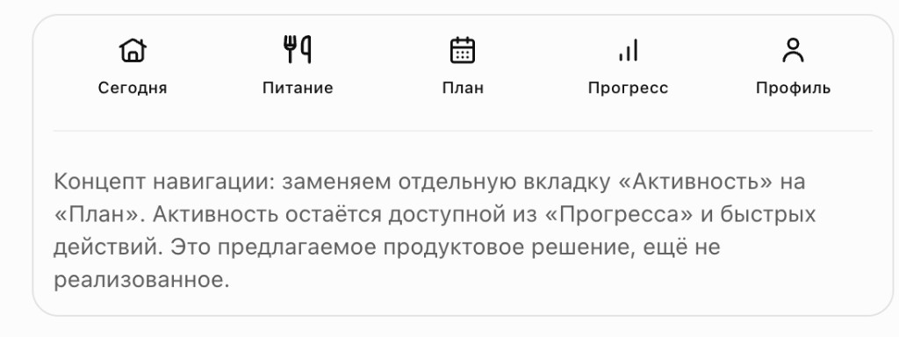
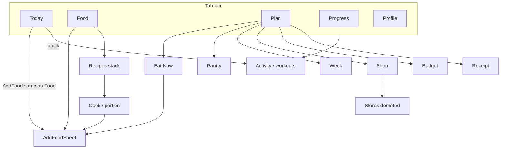

# Target Information Architecture — Momentum 2.0

| Field | Value |
|-------|--------|
| **Status** | Target / pending implementation (D2) |
| **Source** | [`15-MOMENTUM-2.0-VISION-AND-ROADMAP.md`](./15-MOMENTUM-2.0-VISION-AND-ROADMAP.md) |
| **AS-IS** | [`03-INFORMATION-ARCHITECTURE.md`](./03-INFORMATION-ARCHITECTURE.md) |
| **Date** | 2026-10-24 |

---

## Decision summary

| Change | Rule |
|--------|------|
| Tab bar | Today · Food · **Plan** · Progress · Profile |
| Remove from tab bar | **Activity** as top-level tab |
| Preserve | All workout data, forms, history |
| Activity access | Progress → Activity section/tab + Today quick actions |
| Plan | Former `/plan/*` surfaces as **root tab**, not nested «second app» |
| Recipes | Primary browse under **Food**; cook/plan actions also from Plan |
| Stores | Not a tab; preference under Shopping / Profile (FI-21) |
| Max tabs | **5** — no sixth |

---

## Tab contracts

### Сегодня `/`

**Job:** What matters **right now**.

| Zone | Content | Priority |
|------|---------|----------|
| Status | Remaining KBJU vs targets | Primary |
| Next action | One CTA: choose dinner / repeat lunch / cook planned | Primary |
| Recent | Re-log with last grams default | Primary |
| Day plan strip | Short planned meals | Secondary |
| Habits / water | Compact | Secondary |

**Must not:** Dump entire Plan hub, budget, stores, long forms.

### Питание `/food`

**Job:** What I ate + what I can log.

| Content | Notes |
|---------|--------|
| Diary by meal | Canonical structured log |
| Search / catalog / favorites | Same AddFood semantics as Today (UX-01) |
| Recipes entry | Library, create funnel (FI-08) |
| Barcode / manual | Same sheets |

### План `/plan` (tab)

**Job:** What to cook and buy.

| Child | Route (keep stable where possible) |
|-------|-------------------------------------|
| Hub or default Eat Now / Week | TBD wireframe — prefer **Week or Eat Now** as landing, not link farm |
| Eat Now | `/plan/eat-now` |
| Pantry | `/plan/pantry` |
| Week | `/plan/week` |
| Shop | `/plan/shop` |
| Budget | `/plan/budget` |
| Receipt | `/plan/receipt` |
| Stores | `/plan/stores` — demoted deep link |

**Migration rule (UX-04):** All existing deep links keep working; redirects OK; no data loss.

### Прогресс `/progress`

**Job:** How results change.

| Content |
|---------|
| Weight (+ soft delete, sparkline) |
| Nutrition trends |
| **Activity / workouts** (relocated primary home) |
| Habits / challenges (challenges lower visual priority — D9) |

### Профиль `/profile`

**Job:** Configure app.

Goals, water, export/restore, privacy, data sources, advanced prefs.

---

## Overlay / sheet policy (unchanged pattern)

Keep **local-state sheets** (not route modals): AddFood, ConfirmPortion, Barcode, Calendar, Workout, Recook, SaveMeal, PortionEdit.

**UX-01:** Today and Food must open the **same** AddFood / ConfirmPortion pipeline (shared component + identical defaults).

---

## Navigation graph (target)

---

## Dead ends to eliminate

| AS-IS problem | Target fix |
|---------------|------------|
| Plan hub as second app | Plan is a tab with clear landing |
| Activity competes with FI focus | Under Progress |
| Stores as peer surface | Under shop prefs |
| Triple recipe create | One funnel under Food/Recipes (FI-08) |
| Today vs Food different log semantics | Shared pipeline UX-01 |

---

## Acceptance for IA cutover (UX-04 + QA-07)

1. Tab bar shows Plan; Activity not in tab bar.  
2. Every former Activity entry point still reachable ≤2 taps from Progress or Today.  
3. All `/plan/*` and `/recipes/*` routes resolve (redirect map documented in PR).  
4. No silent loss of workout / plan / pantry data.  
5. Navigation regression checklist green on web + Android smoke subset.  
6. Founder confirms D2 before merge of tab cutover PR.

---

## Wireframe next (before code)

PROPOSED order of design artifacts:

1. Today fold (status + one CTA + recent)  
2. Plan tab landing  
3. Progress with Activity section  
4. Redirect/deeplink table  

Do **not** implement tab swap in the same PR as Eat Now algorithm changes.
