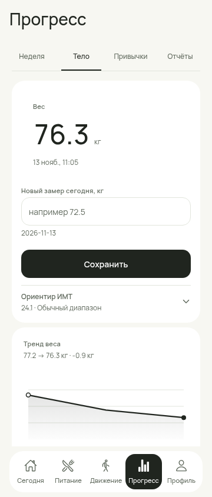
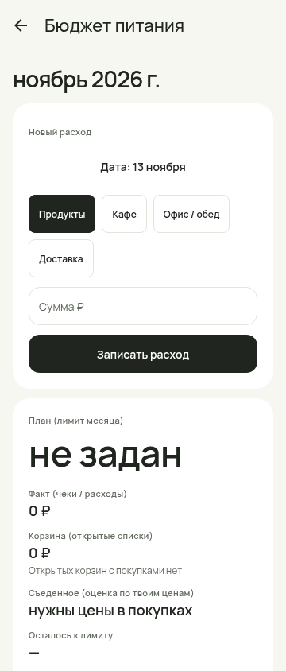
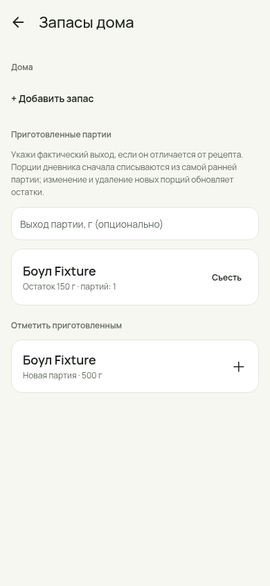
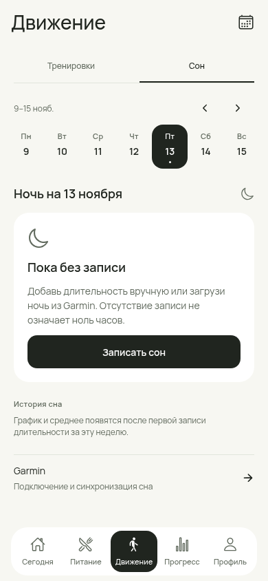

# Доводка интерфейса, функций и кода — 14 ноября 2026

Продолжение [полного аудита](FULL-AUDIT-2026-11-14.md), issue #234. База `3eebabe` / draft PR #233; ветка `feat/234-durability-network`. Сохранён одобренный Fresh Utility, пять вкладок и единая система токенов. Изменения охватывают визуал, пользовательские сценарии и надёжность данных/сети.

## Исправленные проблемы

| Приоритет | Проблема и пример | Результат |
|---|---|---|
| P1 data | Списание готового блюда жило во временной Map, использовало одну партию; после reload редактирование/удаление порции не возвращало остаток. | Новые порции сохраняют `cookedConsumption`. FIFO расходует несколько партий. Для 70 + 130 г порция 150 г оставляет 0 + 50 г; изменение до 75 г оставляет 35 + 90 г; Undo возвращает 0 + 50 г. Удаление/восстановление работает после повторной загрузки. |
| P1 data | Повторная отмена могла повторно восстановить остаток; вложенные ссылки из чтения позволяли менять внутреннее состояние. | Идемпотентные delete/Undo, проверка всей операции перед изменением партий, глубокие копии связи. Copy создаёт новое списание; не заимствует старое. Перенос даты/приёма не меняет склад. |
| P1 network | Запрос Garmin мог бессрочно ждать headers или body; отмена не прекращала загрузку истории и fallback деталей. | Общий транспорт с 20 с на запрос, включая body; отмена останавливает чанки и воркеры. Даже fetch, игнорирующий AbortSignal, не удерживает UI. Кнопка отмены закреплена снизу; уход с экрана отменяет запрос. |
| P1 privacy | Завершение отложенной записи ключа/токена после очистки могло вернуть credentials. | Проверки wipe epoch вокруг SecureStore; запоздалая запись ключа удаляется. 401 останавливает дальнейшие чанки и сбрасывает bearer для повтора. Без вывода ключей и ответов сервера в ошибки. |
| P2 UX | Вес и расходы требовали прокрутки через графики/аналитику. | Ввод веса и кнопка сохранения выше графика, график вынесен из вложенной карточки. В бюджете расход — первая карточка, дата явно выбирается через общий календарь; пояснение раскрывается по запросу. |
| P2 UX | В запасах отображалось «Пока пусто» при наличии готовой еды; повторялись действия, «Съесть» открывало общий подбор. | Честное пустое состояние, одна команда добавления; одинаковые готовые блюда объединены по рецепту. «Съесть» открывает порцию конкретного блюда с датой и приёмом, запись поддерживает Undo. Готовка защищена от быстрого двойного тапа и тоже поддерживает Undo. Ошибка выхода партии видна рядом с формой. |
| P2 visual | Пустая неделя сна показывала пустой график и неизвестные средние. | До первой длительности — компактное объяснение. При появлении записи возвращаются график и средние по известным ночам. Подтверждённый нулевой счётчик силовых показан как 0; единицы покупок локализованы. |
| P2 robustness | Неверный `last_updated_t` Open Food Facts мог вызвать исключение при разборе корректного продукта. | Некорректная дата остаётся неизвестной. Существующий XHR транспорт сохранён, чтобы не вернуть прежнюю проблему native AbortSignal. |

## Примеры интерфейса

Все изображения сняты с работающего Expo web на синтетических данных; это не макеты и не физический Android.

| Вес: действие перед графиком | Бюджет: расход первым |
|---|---|
|  |  |

| Готовое блюдо: остаток и прямой ввод порции | Сон: нет записей |
|---|---|
|  |  |

Дополнительно: [порция выбранного блюда](followup-234/screens/prepared-stock-portion.png), [объединённые партии](followup-234/screens/prepared-stock-grouped.png), [сон с фактической длительностью](followup-234/screens/activity-sleep-filled-390.png), [календарь расхода](followup-234/screens/budget-date-picker.png).

## Проверка

Итоговые результаты команд и браузерных сценариев — в [evidence](followup-234/README.md). Автоматические tests покрывают FIFO, restart/export/import, edit/delete/Undo, legacy, недостающую/удалённую партию, атомарный отказ, защиту от мутации, перенос даты; headers/body timeout, cancel, остановку fallback/чанков, безопасную ошибку, 401 и отложенный SecureStore write после wipe.

Браузер проверяет фактический JSON после добавления, reload, изменения и отмены порции; прямое «Съесть», double tap готовки и Undo; запись/отмену расхода, календарь, ручной сон и возвращение графика. Три ширины: 360/390/430 px, включая форму запасов и раскрытые пояснения бюджета. Обнаруженный лишний текстовый узел в View пояснения удалён, повторная проверка этого состояния выполнена.

## Совместимость и риск

- SQLite и версия снимка **20** не меняются. `FoodEntry.cookedConsumption` — необязательное поле JSON. `undefined` означает исторически неизвестное происхождение; `[]` — новую отслеживаемую порцию без доступного остатка. Никакого ретроспективного списания старых записей. Увеличение порции списывает только добавленную массу, уменьшение пропорционально возвращает известную часть.
- При нехватке готового остатка дневник всё равно принимает фактически съеденную порцию; связь содержит только списанную часть. Удалённые или отсутствующие партии не восстанавливаются по догадке. Undo, которому не хватает уже использованной партии, отклоняется целиком с сообщением.
- Отмена синхронизации сохраняет записи, уже полученные до отмены. Полная история может занимать несколько минут: ограничено ожидание отдельного запроса, не вся здоровая синхронизация. Новых зависимостей, разрешений, отправки здоровья или SQL-миграций нет.
- Перед обновлением сохранить JSON. Откат к #233 возможен, но старая версия не поддерживает новый контракт списаний: работа с партиями в старой версии после отката нарушит эту связь. Для надёжного отката использовать экспорт, сделанный до обновления; не переносить отредактированный старой версией склад обратно без проверки.

## Оставшиеся проверки

Физический Android: сохранность после force-stop, обновление поверх APK, реальные SecureStore/Garmin и слабая сеть, отмена на фоне/Back, drag тренировок, TalkBack/крупный шрифт, клавиатура/safe areas, камера/OCR, замер повторного ввода ≤10 с и производительности SQLite. Эти проверки не отмечены Pass; PERFORMANCE-BASELINE Device не менялся.

Архитектурное ограничение целого JSON-снимка остаётся; его замена требует замеров на устройстве и отдельной безопасной миграции. Закрытый здесь дефект происхождения новых списаний не устраняет неопределённость исторических порций.
