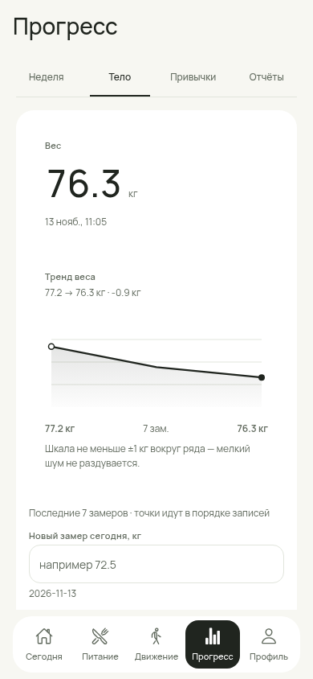
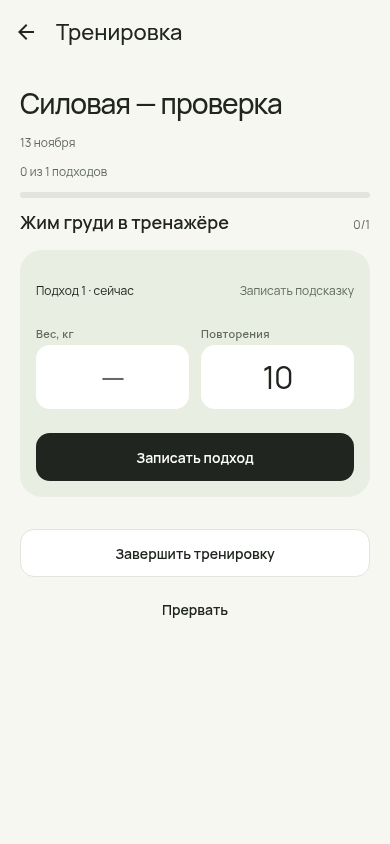

# Аудит и доводка nf-fit — 14 ноября 2026

**Задача:** проверить актуальное приложение со всех сторон и исправить обнаруженные дефекты, сохранив одобренный Fresh Utility. База: `1decfb9` / PR #231. Работа: issue #232, ветка `feat/232-app-quality-audit`.

**Результат:** исправлены проблемы обновления данных, импорта, обратимости действий, расчёта бюджета, рецептов, доступности и очистки личных файлов. Проверены все основные разделы приложения, включая вложенные формы. Автоматические и браузерные проверки описаны ниже. Физический Android, live Garmin и native OCR остаются отдельными проверками; этот отчёт не подменяет device dogfood.

## Что исправлено

| Приоритет | Проблема до изменения | Поведение после изменения |
|---|---|---|
| P1 · данные | Импорт проверял только верхний уровень JSON; некорректные строки могли заменить исправные данные | Проверка профиля/часового пояса, таблиц, уникальности ID, чисел, дат, перечислений и вложенных структур до замены. Ошибочный импорт оставляет прежний снимок целиком |
| P1 · данные | Явное `waterTargetMl: null` превращалось в 2000 при загрузке | Отсутствующее legacy-поле получает прежнее значение по умолчанию; явный `null` сохраняется |
| P1 · сводки | `useMemo` в Прогрессе не учитывал ревизии еды/сна/активности; похожий дефект был в планировщике, запасах, календаре и Garmin | Сводки и списки обновляются после изменения и Undo, без перезапуска и смены выбранного дня |
| P1 · тренировки | Выполненные силовые сессии отсутствовали в общих сводках и отчётах | Общая проекция фактов включает записи активностей и завершённые силовые сессии; планы/черновики/отменённые сессии не считаются выполненными. Челленджи используют те же факты; привычки получают отметку завершённой силовой один раз |
| P1 · UX | Уведомления во вложенных разделах могли отсутствовать; несколько вкладок одновременно владели показом | Один `FeedbackHost` над навигацией. Уведомления и Undo работают после переходов; учитываются нижняя навигация и кнопка еды |
| P1 · Undo | Отмена обновляла только дневник, «Движение» имело отдельную локальную отмену | Общий механизм с областью обновления, сроком действия и защитой после wipe/import. Новое уведомление заменяет устаревшую отмену |
| P1 · рецепты | Форма не ожидала асинхронного сохранения; ошибка фото могла скрыться, повторное нажатие создавало дубликат | Ожидаемое сохранение, блокировка повторной отправки, ошибка в форме. Фото копируется до создания/редактирования записи; сбой не маскируется временным URI |
| P1 · рецепты | Изменение рецепта могло частично записать название/состав до ошибки | Валидация и сборка нового состояния до замены рецепта и ингредиентов |
| P1 · рецепты | Открытие редактирования могло пересчитать введённые калории; пустая масса ингредиента превращалась в ноль | Имеющиеся значения и неизвестные калории сохраняются до изменения БЖУ пользователем; пустая масса требует исправления |
| P1 · бюджет | Цена чека за грамм/мл читалась как ₽/кг/л; цена наблюдения попадала в корзину без пересчёта объёма | У нового наблюдения есть `basisQuantity`: количество г/мл/шт, за которое дана цена. Корзина считает цену недостающего количества; оценка съеденного использует реальную базу цены |
| P1 · бюджет | Цена строки из нескольких штук записывалась как цена одной штуки; `2 кг × 100` разбиралось неверно | 3 шт за 120 ₽ → 40 ₽/шт; 2 кг × 100 ₽ → 200 ₽ за строку. Граммы не переводятся в мл или штуки без фактического соответствия |
| P1 · бюджет | Неоднозначные старые наблюдения могли давать неправдоподобную оценку | Исходные значения сохраняются. Без известной базы цены производная оценка остаётся неизвестной; автоматической «починки» истории нет |
| P1 · атомарность | Переполнение производной цены могло оставить часть чека/строки записанной | Проверка исходных и производных чисел до записи; невалидный чек не создаёт продукты, запасы, цены или расходы |
| P1 · приватность | Полная очистка не удаляла собственные копии фото рецептов; скрытые формы сохраняли прежние данные | Удаляются файлы из приватного каталога рецептов. Сбрасываются загруженные формы/навигация/Undo; переход на пустое «Сегодня». Асинхронные фото/копии не восстанавливают данные после wipe; удаление виджета ждёт предыдущие записи и сообщает об ошибке очистки |
| P1 · приватность | Android-конфигурация разрешала системное резервное копирование данных приложения | `android.allowBackup=false`. Перенос — через явно запущенный экспорт; новые разрешения не добавлены, микрофон остаётся заблокирован |
| P1 · приватность / медиа | URI фото из JSON мог вызвать запрос к произвольному внешнему серверу | Компонент фото принимает локальные URI/data URI; внешний или недоступный файл показывает понятную заглушку. Исходный URI в данных не удаляется |
| P1 · доступность | У нижних вкладок не было группы, часть checkbox/radio не передавала состояние, прогресс силовой имел неверную роль | Корректные группы и состояния; роль и числовое значение progressbar. Исправлен контраст подписей на поверхности силовой через общий токен |
| P2 · вес | Ручной ошибочный замер нельзя было исправить/удалить; история ограничивалась последними 30 строками | Редактирование и удаление ручного замера с Undo; дата и источник сохраняются. История загружается порциями, график явно показывает последние 30 измерений. Garmin/Zepp доступны для просмотра |
| P2 · вес | `listWeights` возвращал изменяемые внутренние объекты | Возвращаются копии; редактирование и отмена не изменяют сохранённый исходный снимок по ссылке |
| P2 · привычки | Количество можно было только увеличивать на 1; некорректное значение могло превратиться в 1; ошибка редактирования оставляла часть полей | Один редактор итога дня в Сегодня/Прогрессе, строгая валидация, атомарное редактирование, Undo создания/изменения/удаления/отметки/паузы. Пауза объяснена и блокирует отметки. Автозачёт не превращает минуты в км или страницы |
| P2 · план питания | Добавление/перенос/порция/удаление не имели единой отмены, пустая порция молча игнорировалась | Ошибка рядом с формой; немедленное обновление доски; Undo добавления, переноса, порции и удаления. Отмена «Съел» возвращает статус плана и остаток приготовленной партии |
| P2 · покупки | Сохранение показанной цены без редактирования очищало её; ошибочный ввод создавал пустой список | Сохраняется показанное значение. Проверка названия и количества до создания списка, актуальный выбор доступной корзины |
| P2 · формы | Пустая сумма расхода записывалась как 0; удаление запасов/расходов не имело Undo | Пустая сумма требует ввода; ноль возможен только при явном вводе. Расходы и удаление запасов обратимы |
| P2 · продукт | В «Что съесть сейчас» минуты приготовления выдавались из фиксированных констант | Пока у рецепта нет измеренного/введённого времени, показывается неизвестное. Фильтры с неподтверждённым обещанием «до 15 мин / без готовки» убраны |
| P2 · платформы | Часть подтверждений использовала неработающие на web кнопки `Alert`; меню фото превышало лимит Android | Общий механизм подтверждения и прокручиваемое меню фото. Ошибки формирования/копирования отчёта видны |
| P2 · силовые | Предзаполненные значения из шаблона назывались «Как в прошлый», даже без предыдущей сессии | Действие явно называется «Записать подсказку»; неизвестный вес не выдаётся за прошлое измерение |
| P2 · числа | Округление сна могло дать `7:60`; старый выбранный день терял вес из-за ограничения 30/90 записей | Минуты округляются до разбиения на часы; календарь/отчёты/месячная сводка читают нужную историю |

### Пример проверки бюджета

Синтетический чек: **2 кг муки × 100 ₽/кг = 200 ₽**. В запасах — 2000 г. Дневник на 250 г даёт оценку **25 ₽**. Для рецепта на 2500 г недостаёт 500 г: оценка корзины — **50 ₽**. После export/import значения сохраняются. Наблюдение без `basisQuantity` даёт «неизвестно», исходная цена не переписывается.

## Матрица разделов

| Раздел | Проверено и доведено | Доказательства |
|---|---|---|
| Сегодня | Дата, быстрый повтор, итог дня, вода/привычки, переходы, общий Undo, работа загруженного приложения без сети | [Экран](app-audit-232/screens/today-390.png), regression-сценарии Today/Food + новый межвкладочный прогон |
| Питание | Дневник/каталог, снимки порций и unknown, общий feedback; исходные сценарии #231 сохранены | [Экран](app-audit-232/screens/food-390.png), [предыдущая подробная проверка](today-food-230/README.md) |
| Движение | Цикл/план/факты, завершённые силовые, Garmin-вело, общий Undo; завершённая история не перетаскивается как план | [Экран](app-audit-232/screens/activity-390.png), domain regression tests |
| Сон | Ручной ввод/отмена, отсутствие данных, обновление недельной сводки после ввода | [Экран](app-audit-232/screens/activity-sleep-390.png), [сводка после записи](app-audit-232/screens/progress-reactive-sleep.png) |
| Силовые | Шаблон, активная сессия, поля подхода, прогресс и контраст | [Шаблон](app-audit-232/screens/strength-template-390.png), [сессия](app-audit-232/screens/strength-session-390.png) |
| Прогресс — неделя | Обновление после еды/сна/Undo без перезагрузки, числа, неизвестные данные | [После еды](app-audit-232/screens/progress-reactive-food.png) |
| Прогресс — тело | Новый замер сегодня, история, исправление/удаление/Undo, неизменная дата, защита интеграционных строк | [Экран](app-audit-232/screens/progress-body-390.png), [редактор](app-audit-232/screens/weight-edit.png) |
| Прогресс — привычки | Итог количества за выбранный день, создание/редактирование, удаление и возврат истории, пауза | [Экран](app-audit-232/screens/progress-habits-390.png), [Undo](app-audit-232/screens/habit-day-value-undo.png) |
| Прогресс — отчёты | День/период, силовые факты, старые замеры, ошибки буфера/PDF, неизвестная длительность | [Экран](app-audit-232/screens/progress-reports-390.png), tests отчётов |
| Профиль | Цели и null-значения, импорт до замены, экспорт, wipe, сброс экранов, приватность | [Экран](app-audit-232/screens/profile-390.png), [после wipe](app-audit-232/screens/wipe-clears-navigation-and-undo.png) |
| Рецепты | Список/импорт текста/архив/создание/редактирование/детали; защита сохранения, состав, фото, удаление/Undo | [Редактор](app-audit-232/screens/recipe-edit-390.png), [фото недоступно](app-audit-232/screens/recipe-unavailable-photo.png) |
| План недели | Добавление, некорректная порция, перенос, изменение порции, удаление/Undo; план не пишет в дневник | [Доска](app-audit-232/screens/week-plan-add-undo.png) |
| Что съесть сейчас | Данные из запасов/каталога/рецептов, реактивность, явное подтверждение порции, отсутствие выдуманного времени | [Экран](app-audit-232/screens/plan-eat-now-390.png) |
| Запасы | Пустое/заполненное состояние, приготовленные партии, валидация даты/единицы, удаление/Undo | [Экран](app-audit-232/screens/plan-pantry-390.png), [после покупки](app-audit-232/screens/purchase-pantry-feedback.png) |
| Покупки / магазины | Список, количество, цена без потери при повторном сохранении, пересчёт базы цены, radio/checkbox | [Экран](app-audit-232/screens/shopping-price-feedback.png), [магазины](app-audit-232/screens/plan-stores-390.png) |
| Импорт покупок | Предпросмотр без записи; явное подтверждение → запасы + расход; дедупликация/атомарность в tests | [Предпросмотр](app-audit-232/screens/purchase-preview.png) |
| Бюджет | Пустая сумма, расход/Undo, расчёты единиц, неизвестные цены, отделение лимита/факта/корзины/оценки съеденного | [Экран](app-audit-232/screens/plan-budget-390.png), [расход/Undo](app-audit-232/screens/budget-expense-undo.png) |
| Garmin | Подключение/списки/детали синтетической поездки; обновление списков; code review SecureStore, синхронизации и ошибок | [Подключение](app-audit-232/screens/garmin-390.png), [поездка](app-audit-232/screens/garmin-ride-390.png) |

## Примеры визуальной доводки

| Ручной вес и единая типографика | Силовая: доступный контраст и явное действие |
|---|---|
|  |  |

## Проверки

- `npm run verify`: **378/378 tests**, полный TypeScript, domain/regression tests, security scan, mobile TypeScript, проверка совместимости Router/зависимостей. Итоговые числа и журналы — в [evidence](app-audit-232/README.md).
- **16 новых regression tests** проверяют ошибочный импорт без потери исходных данных, legacy/null, атомарность рецептов/привычек/чека/цены, корректность бюджета после перезапуска, факты силовых, ручной вес и его источник, Undo плана/остатков, отсутствие выдуманного времени, Android privacy config.
- Chromium / Expo web: 21 маршрут на **360 / 390 / 430 px**, затем 3 сегмента Прогресса и вложенные детали рецепта/шаблона/сессии/поездки на тех же ширинах. Горизонтального переполнения и исключений JavaScript не обнаружено.
- Содержательные browser-сценарии отдельно проверяют хранение после reload, работу без сети в уже загруженном web-приложении, Undo после перехода, фактические записи в JSON-хранилище. Проверка web reload не считается Android force-stop.
- axe-core 4.10.3: WCAG A/AA/2.1 A/AA для основных маршрутов, дополнительных состояний и fallback фото. Исправлены найденные нарушения. Нулевая автоматическая выдача не заменяет TalkBack и проверку крупного шрифта на телефоне.
- `npm audit`: **0 известных уязвимостей** в root и mobile на дату аудита. Это проверка зависимостей, а не гарантия отсутствия любых проблем безопасности.
- Android JS/Hermes export выполнен; конфигурация Expo проверена. Это не установка и не тест APK на устройстве.
- Node benchmark на 10 000 записей: измерены parse+validation, serialize, dailyTotals и поиск. Снимок около **3,83 MB**. Числа и окружение — в evidence; колонка Device в PERFORMANCE-BASELINE не менялась.

## Совместимость данных и ограничения

1. Схема SQLite не менялась; версия снимка остаётся 20. `ProductPrice.basisQuantity` — необязательное аддитивное поле. Старые цены/чеки/дневник не пересчитываются. После загрузки legacy-цены без базы производная оценка недоступна до новой явной записи цены.
2. Завершённые силовые учитываются по времени между стартом и завершением **включая отдых**. Это не измерение активных минут или энергозатрат. Калории сессии не выдумываются. Ручная активность и силовая сессия не объединяются по догадке; автоматического дедупа по названию/дате нет.
3. JSON переносит записи, но не фотофайлы на другое устройство. Показана заглушка; рецепт и его исходный URI сохранены. Полная очистка удаляет собственные копии фото, но не оригиналы из галереи и не экспортированные пользователем файлы вне приложения.
4. Undo добавления порции восстанавливает использованный остаток партии. Историческое редактирование/удаление старой порции не пересчитывает склад: у старых строк нет долговечной связи с конкретной партией. Для такого поведения нужен отдельный контракт происхождения остатков, с явной миграцией и проверкой на устройстве.
5. Сохранение целого JSON-снимка остаётся архитектурным ограничением. Node p95 не переносится на Android; решение о разбиении хранения на SQL-таблицы следует принимать по замерам устройства, с сохранением recovery.

## Что осталось подтвердить на реальном Android

| Проверка | Статус |
|---|---|
| Установка сборки этой ветки, обновление поверх установленной версии, сохранность после force-stop | **Pending device** |
| Drag между днями + auto-scroll + доступный перенос без drag | **Pending device**; domain/browser проверки не являются нативным жестом |
| Клавиатура, системная навигация Back, safe areas, крупный системный шрифт, TalkBack | **Pending device** |
| Камера, галерея, постоянное фото после очистки кэша, файловый sharing/PDF | **Pending device** |
| Live Garmin: реальный ключ, сеть/401/повтор, сон/поездки, SecureStore failures | **Pending device / credentials** |
| Native OCR: загрузка модели по явному действию, распознавание скрина, отказ/нет сети | **Pending device** |
| Реальный cold start и serialize+SQLite commit на D1k/D10k; повтор еды ≤10 с — пять замеров | **Pending device** |
| Переустановка/перенос: фактические backup rules APK и поведение производителя Android | **Pending device**; `allowBackup=false` проверен в конфигурации, не в установленной новой APK |

Не отмечать эти строки Pass в Visual Audit или PERFORMANCE-BASELINE без фактического прогона. Приложение стало надёжнее по проверенным сценариям; абсолютная «идеальность» не является измеримым критерием готовности.

## Риск и откат

Наибольшая площадь изменения — общий feedback, проверка импорта и обновление сводок. Их покрывают межвкладочные сценарии, отрицательные tests и перезапуск. Изменения цены намеренно делают неоднозначные legacy-оценки неизвестными. Новых разрешений, backend и автоматической отправки здоровья не добавлено. Android backup отключён в конфигурации этой ветки.

Перед сменой установленной версии сохранить JSON. Для отката — возврат к базе #231 / `1decfb9`; аддитивное поле цены старая версия игнорирует. Деструктивных преобразований истории и схемы хранения нет. Работа оформляется отдельным draft PR поверх #231; main и production-релиз автоматически не меняются.
