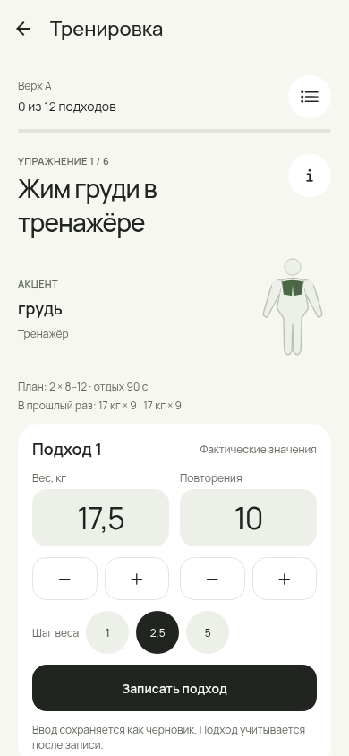
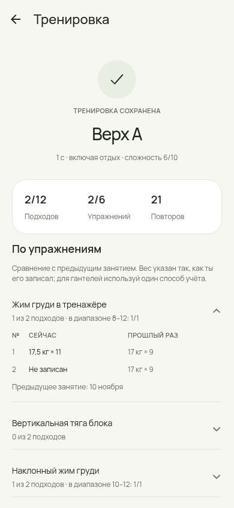
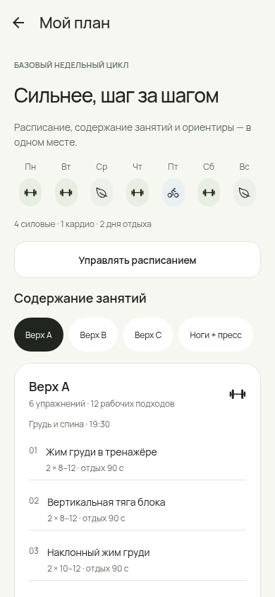
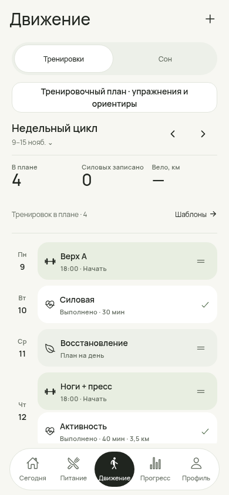

# Интерактивный зал и визуальная доводка — 14 ноября 2026

Issue #236, ветка `feat/236-interactive-gym`, база #235 / `9cb17a2`. Задача основателя — удобный ввод в зале, последующая сводка, доступное описание плана и согласованный визуальный язык приложения. Референс использован для композиции «одно упражнение — крупный ввод — основное действие».

## Что изменилось

### Во время занятия

- Вместо длинной формы всех упражнений — одно упражнение в фокусе: название, схема группы мышц, оборудование, ориентиры повторений/отдыха и предыдущие фактические подходы.
- Крупные поля веса и повторов с кнопками ±, выбором шага веса 1 / 2,5 / 5 кг. Подсказка плана или прошлого занятия становится фактом после явной записи подхода.
- Незавершённый ввод сохраняется отдельно от фактического результата, включая явно очищенное поле. Reload восстанавливает черновик; он не увеличивает число выполненных подходов.
- Таймер отдыха сохраняет абсолютный срок, поддерживает +30 секунд и пропуск. Пропущенный отдых не появляется снова после reload. Изменение уже записанного подхода не запускает новый отдых и не переписывает исходное время выполнения.
- Список упражнений, прямой выбор подхода, редактирование и Undo; отмена закрытой сессии не остаётся доступной. дополнительные подходы меняют эту сессию. Быстрое повторное нажатие записи/добавления защищено. Переход к другому упражнению оставляет незаписанные подходы незаписанными.
- Схема мышц — декоративное обозначение акцента, не демонстрация техники упражнения. Новых скачиваемых изображений и зависимостей нет.

### После занятия

Завершение открывает сохранённую сводку на том же экране: подходы, упражнения, фактические повторы, время включая отдых, необязательные оценка сложности и заметка. Частично известные повторы помечены как частичная сумма; отсутствие не превращается в 0.

Каждое упражнение раскрывается в таблицу «сейчас / прошлый раз» по номеру подхода. Предыдущее занятие выбирается среди завершённых **до старта текущей сессии**; просмотр старой истории не сравнивается с будущей. Видно попадание известных повторов в сохранённый диапазон. Если повторов нет, оценки попадания тоже нет. Калории, медицинские выводы и автоматические назначения нагрузки не вычисляются. Вес показывается в записи пользователя; для гантелей важно сохранять одинаковый способ учёта.

### Тренировочный план

Новый экран «Мой план» доступен из Сегодня, Движения и раздела силовых. Показывает текущий повторяющийся цикл либо базовый цикл, силовые/кардио/отдых, состав каждого занятия, рабочие подходы, диапазоны и отдых. Базовый цикл сохраняет среду и воскресенье для отдыха, велосипед — в пятницу. Ориентиры разминки/отдыха/прогрессии раскрываются по запросу.

Редактор позволяет сохранить описание занятия и заметки к каждому упражнению. При старте сессии фиксируются название, оборудование, группы мышц, исходные подходы/повторы/отдых/заметки. Изменение шаблона позднее не меняет историю. Существующие пользовательские шаблоны, календарь и фактические веса автоматически не заменяются.

При работе с предоставленным текстом в публичные исходники не добавлены личные замечания о здоровье и фактические веса. Описание и заметки, введённые пользователем в приложении, хранятся локально и входят в его JSON-экспорт.

### Всё приложение

Обновлены общие карточки, кнопки, подписи полей, скругления, переключатели, заголовки графиков и нижняя навигация. Нейтральный фон, Manrope, сдержанные цвета силовых/вело и пять вкладок сохранены. В выборе упражнения для анализа доступны все упражнения вместо первых восьми.

Общие модальные панели получили корректную роль диалога и кнопку закрытия вместо неверно объявленного ползунка; закрытие доступно также клавиатурой. Кнопки и ручка панели сохраняют доступную область нажатия.

## Работающий интерфейс

Изображения сняты с Expo web на синтетических данных. Они не являются физическим Android тестом.

| Ввод в зале | Разбор занятия |
|---|---|
|  |  |

| Содержание плана | Обновлённое Движение |
|---|---|
|  |  |

**Проверено:** 411/411 tests, root/mobile TypeScript, secret scan, совместимость зависимостей и Android Hermes export. 87 состояний на трёх ширинах — 0 overflow, 0 автоматических нарушений axe, 0 JS exceptions.

Все вкладки и вложенные формы: [скриншоты](interactive-gym-236/screens/). [Журналы и результаты](interactive-gym-236/README.md).

## Совместимость, риски и откат

- SQLite и версия JSON-снимка остаются прежними (20). Новые поля необязательные: `WorkoutSession.exercisePlan/planNotes/restUntilAt`, `WorkoutSet.draftWeightText/draftRepsText`, `WorkoutTemplate.notes`. Старые сессии без снимка плана остаются без него; сведения из нового шаблона задним числом не придумываются.
- `restUntilAt=null` означает явно завершённый/пропущенный отдых; отсутствующее поле — legacy. Поля ввода являются черновиком, а не выполненной работой. Подтверждение очищает черновик. Снимки плана глубоко копируются, импорт проверяется до изменения данных.
- Замена упражнений шаблона сначала проверяет весь новый список и затем меняет его. Неверная строка больше не удаляет предыдущие упражнения. Длинные старые заметки сохраняются целиком, без усечения.
- Наиболее заметный риск — глобальные общие стили и новое представление сессии. Проверены все пять вкладок, вложенные формы и состояния зала на трёх ширинах. Откат — к #235; перед обновлением сохранить JSON. Старая версия не понимает новые черновики/снимки плана и может потерять эти добавочные сведения при повторном сохранении. Для отката использовать предшествующий экспорт.
- Остаётся архитектурное ограничение целого JSON-снимка. Новый фокус не копирует данные питания/фото для анализа при каждом нажатии: история силовых читается отдельно. Реальная скорость SQLite и ввода на D10k требует устройства.

## Нативные проверки

**Pending device:** Android force-stop, ввод с системной клавиатурой/Back, возврат из фона с таймером, виброотклик, TalkBack/крупный шрифт, жест закрытия панели, drag недельных карточек, реальные Garmin/OCR и производительность. Browser reload, axe и Android export не отмечаются как device Pass. Автоматического main merge и production-релиза нет.
