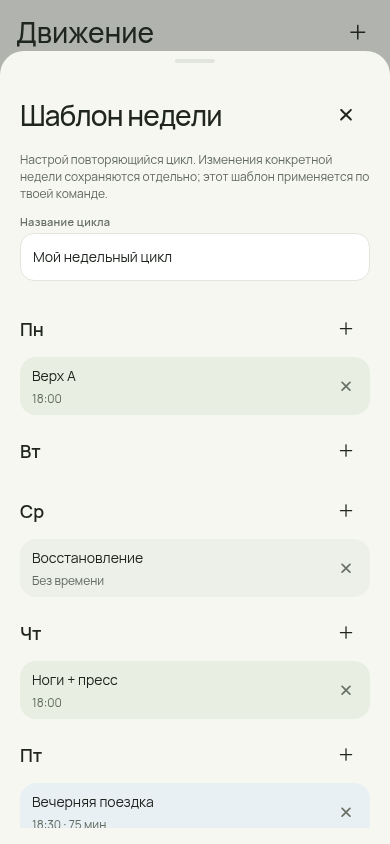
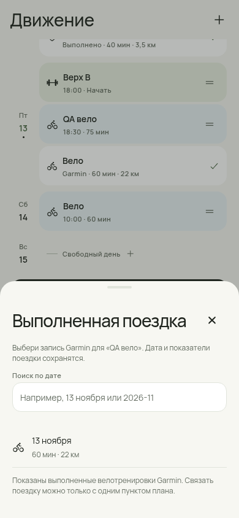
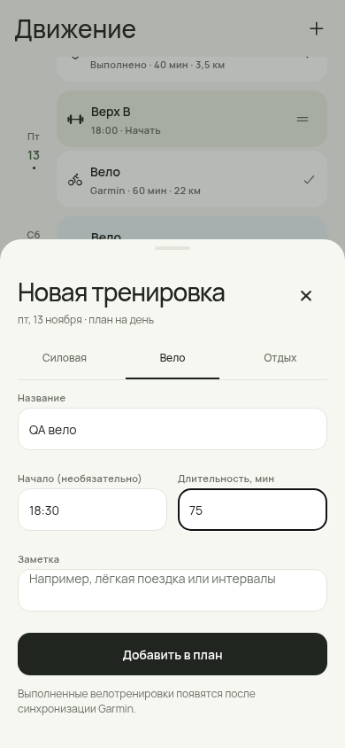
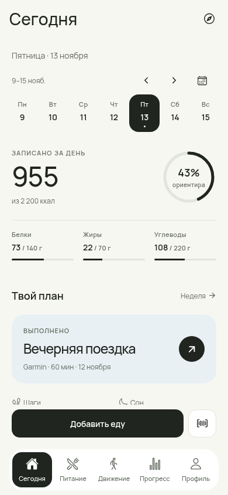
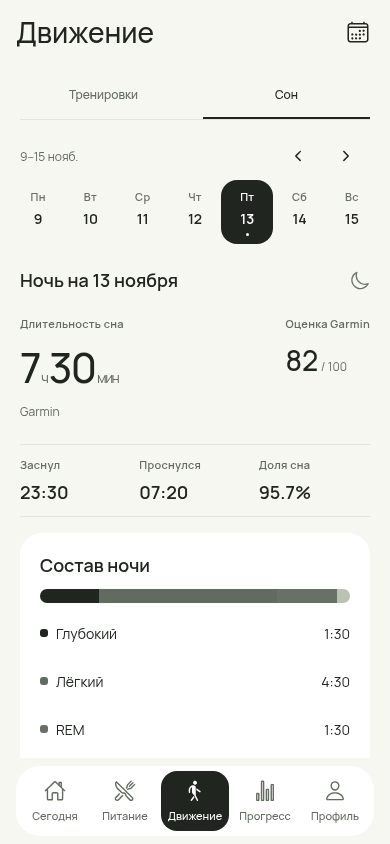
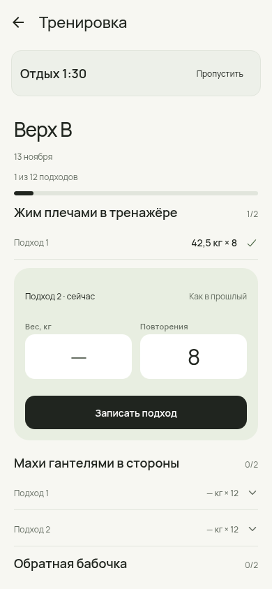
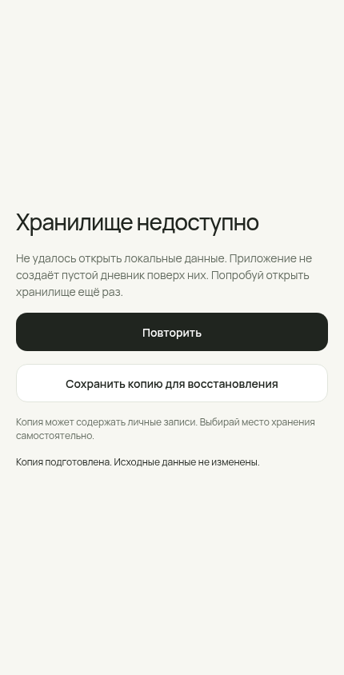
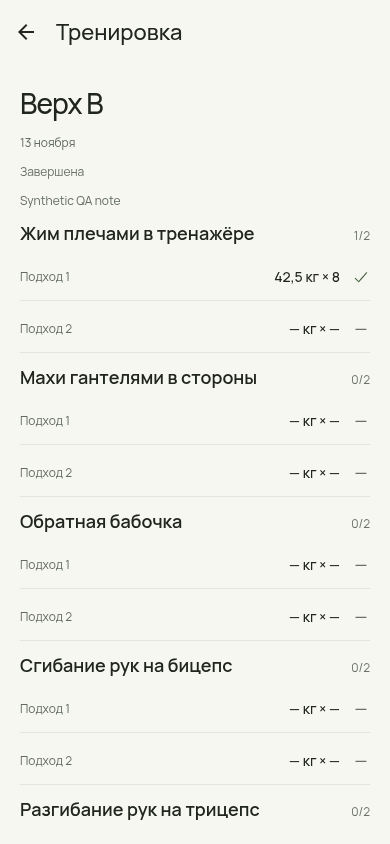

# Продолжение аудита и общая полировка — 13 ноября 2026

Issue #228, поверх PR #227 / `dc2cb15`. Продолжение [аудита «Движения»](../movement-audit-226/README.md). Сохранено одобренное направление Fresh Utility: тёплый фон, Manrope, спокойные поверхности, sage для силовых и голубой для вело. Изменения внесены в приложение, а не только в макеты.

## Что закрыто по плану

| Пункт | Результат |
|---|---|
| P1: выполненное вело ↔ план | Явный выбор поездки Garmin с поиском по дате по всей импортированной истории. Одна поездка связывается с одним пунктом плана. Отмена меняет только связь; исходная дата, дистанция, минуты и история остаются прежними. Копии плана создаются без связи. |
| P2: постоянный недельный цикл | Редактор семи дней: силовые, вело, отдых, название, время и минуты. Шаблон хранится отдельно от датированных недель. Изменение одной недели не переписывает шаблон, сохранение шаблона не меняет существующие недели. |
| P2: будущие недели | «Запланировать 4 недели» заполняет пустые недели начиная с выбранной. Любая неделя с существующим планом пропускается. Есть подтверждение и Undo только для созданных карточек. Фоновая генерация не включается сама. |
| P1: оставшиеся advisory | Совместимые исправления внутри Expo57: production npm audit **6 → 0**. Сохранены CommonJS API Router и привычные deeplinks, без force/несовместимого major upgrade. Подробности ниже. |
| P2: recovery-export | При ошибке открытия хранилища можно явно сохранить сырой читаемый снимок. Оригинал не нормализуется, не перезаписывается и не отправляется автоматически. Браузерная проверка подтверждает точное совпадение выгруженного повреждённого JSON. |
| Дизайн всех экранов | Общие поля Manrope, единые шрифты и размеры действий, спокойные импорты без старых теней, общие цвета графика пульса. Проверены основные и вложенные маршруты на трёх ширинах. |

## Исправления взаимодействия

- В строке активности кнопка удаления больше не вложена в кнопку открытия. Удаление и просмотр имеют отдельные доступные цели; устранена ошибка React DOM на Garmin-строках.
- Отмена межнедельного переноса возвращает и карточку, и выбранную дату на исходную неделю.
- Выполненный связанный велоплан открывает результат Garmin. На «Сегодня» виден статус «Выполнено» и фактическая дата поездки, а не предложение выполнить её снова.
- Выполненные факты не перетаскиваются. Однодневная связанная поездка не дублируется второй строкой на доске. Если факт пришёл за другой день, он сохраняется под настоящей датой; километры недели считаются по датам фактов.
- Редактор шаблона сохраняет введённый текст при обновлении глобального feedback. Ошибка выбора занятой поездки показана внутри открытого sheet.
- Ошибка хранилища прокручивается на небольшом экране; сохранение копии доступно рядом с повторной попыткой.
- Все поля, включая старые формы рецептов, порций, целей, покупок и Garmin, используют локальный Manrope. Нативные ref и параметры TextInput сохранены, явный monospace не подменяется.
- Кнопки переноса, удаления, пресеты, чипы, добавление еды, переключатели и Undo получили минимум48dp. Декоративные метки и полосы не растягивались до размеров кнопок.
- Нулевые зоны пульса не получают выдуманную минимальную ширину. Цвета вынесены в общий источник токенов.
- Экран устаревшей ссылки переведён на русский и использует общую типографику и действие возврата.

## Визуальные примеры

Реальные скриншоты Expo-web / Chromium, **синтетические данные**. Это не Android Device Pass.

| Шаблон цикла | Связь с поездкой |
|---|---|
|  |  |

| Ввод велоплана | Завершённая поездка на «Сегодня» |
|---|---|
|  |  |

| Сон Garmin | Текущая силовая |
|---|---|
|  |  |

| Восстановление | Завершённая силовая |
|---|---|
|  |  |

Полная галерея проверенных экранов:

| Раздел | Скриншоты |
|---|---|
| Пять вкладок | [Сегодня](screens/today.png), [Питание](screens/food.png), [Движение](screens/activity.png), [Прогресс](screens/progress.png), [Профиль](screens/profile.png) |
| Планирование | [Хаб](screens/plan.png), [Сейчас](screens/plan-eat-now.png), [Неделя](screens/plan-week.png), [Запасы](screens/plan-pantry.png), [Покупки](screens/plan-shop.png), [Бюджет](screens/plan-budget.png), [Магазины](screens/plan-stores.png), [Импорт покупки](screens/plan-receipt.png) |
| Рецепты | [Список](screens/recipes.png), [Новый](screens/recipes-new.png), [Из текста](screens/recipes-import-text.png), [Архив](screens/recipes-import-personal.png), [Рецепт](screens/recipes-fix-r-bowl.png), [Редактор](screens/recipes-edit-fix-r-bowl.png) |
| Garmin | [Подключение](screens/garmin.png), [Импортированные данные](screens/garmin-data.png), [Поездка](screens/garmin-workout-synthetic-garmin-ride.png) |
| Силовые и цикл | [Шаблоны упражнений](screens/strength.png), [Редактор упражнения/шаблона](screens/strength-template-tmpl-upper-a.png), [Перенос](screens/move-between-weeks.png), [Изменённый цикл](screens/cycle-template.png), [Применение цикла](screens/cycle-applied.png), [Заполнение будущих недель](screens/cycle-fill-feedback.png) |
| Состояния | [Ручной сон](screens/sleep-manual.png), [Устаревшая ссылка](screens/_qa-not-found.png) |

## Совместимость и безопасность

`query-string7` используется Expo Router через CommonJS с именованными `parse/stringify`. Прямая подмена на ESM-выпуск ломает этот контракт. Поэтому взята **реальная исправленная реализация decode-uri-component0.5.1** с MIT-лицензией; изменён только синтаксис экспорта на CommonJS и добавлен комментарий происхождения. [Источник, контрольная сумма и лицензия](../../../apps/mobile/vendor/decode-uri-component-cjs/SOURCE.md). Файл реализации сверён с upstream-архивом. Локальная зависимость явно закреплена override; это не подавление audit или фиктивное изменение версии старого кода.

`@expo/fingerprint` использует minimatch11.0.8. Проверка совместимости запускается локальным `verify` и CI: фактический Router API, кириллица/плюс/разделители/массивы в query, malformed percent encoding, реальный путь загруженного декодера и glob/negation API fingerprint. Чистый `npm ci` прошёл; `npm ls` показывает правильный локальный decoder без системного fallback.

[Production audit](dependency-audit.json): 0 известных advisory на момент проверки. Это результат базы npm, не заявление об отсутствии всех возможных уязвимостей. Backport требует сопровождения: при совместимом обновлении Router следует удалить локальную копию и override после повторной проверки deeplinks и Android.

Recovery-copy содержит личные записи. Она создаётся только по нажатию пользователя; на Android используется стандартный системный выбор места/получателя. Приватные временные копии приложения входят в полный wipe; уже сохранёнными наружу копиями управляет пользователь. Новых Android-разрешений и удалённого backend не добавлено.

## Данные и откат

Snapshot **v20** добавляет `trainingCycle` и необязательный `PlannedActivity.linkedWorkoutId`. Версии1–19 читаются с пустым шаблоном/связями; дневник, сон, подходы и импортированные факты сохраняются. SQLite schema/таблицы не изменены. Изменение описано в [ADR-012](../../14-DECISIONS.md).

Старый APK с ограничением чтения v19 **не прочитает** сохранённый v20. Для отката UI нужно сохранить поддержку v20; полный downgrade требует отдельного version-aware преобразования и резервной копии. Нельзя просто понизить номер версии JSON или удалять базу. Сырой recovery-export не является ремонтом физически повреждённого SQLite: если SQLite не может прочитать `payload`, выгрузка сообщит ошибку и оставит оригинал на месте.

## Проверки и оставшийся план

- `RNET_SKIP_DOWNLOAD=1 npm run verify`: **353/353**, root/mobile TypeScript, security scan и проверка совместимости зависимостей. Skip относится к локальной загрузке native libraries при установке, не к пропуску тестов.
- Пять новых доменных сценариев: независимость и round-trip цикла; атомарность при ошибочном/удалённом шаблоне; уникальная обратимая связь с поездкой; v19→v20 и wipe; заполнение четырёх недель с сохранением исключений и одной coalesced persist-записью.
- Chromium: **26 маршрутов на360/390/430**, сон, активная/закрытая сессия, недельный редактор, связь с поездкой, Undo и raw recovery download. Горизонтального overflow и необработанных JS page errors нет. [Протокол](browser-verification.json).
- Дополнительный UI-прогон: «Сегодня» открывает связанный Garmin-результат; четырёхнедельное заполнение создаёт15 карточек на синтетическом цикле, существующая неделя сохранена, Undo удаляет только новые планы. [Протокол](browser-cycle-verification.json).
- Android Metro export `--platform android --no-bytecode` проверяет native module graph. Это проверка JS-bundle, не новый APK и не запуск на телефоне.
- [Node microbench](performance-node.json): D10k =3.83MB JSON; serialization p50≈15.3ms, p95≈71.9ms. Замер в общей облачной среде, не Android latency и не время SQLite commit. Он подтверждает стоимость полного снимка, но не обосновывает рискованную SQL-перестройку без device-замеров.

| Приоритет / следующий шаг | Критерий |
|---|---|
| P1: физический Android dogfood | Force-stop после еды/подхода/сна; drag и автопрокрутка; TalkBack/крупный системный шрифт/клавиатура; реальный Garmin sync и OCR. Device/Performance Pass остаются **pending**. |
| P2: измерение хранения | На телефоне зафиксировать cold start, размер снимка, время serialize+SQLite commit и отзывчивость повторного ввода на D1k/D10k. По результатам решить вынос крупных сущностей в отдельные SQL-таблицы; сохранить проверенный recovery и backup. |
| P2: сопровождение зависимостей | Удалить backport после появления совместимого upstream, повторить dependency compatibility и native build. |

Выполнены код, автоматические проверки и браузерная проверка доступных сценариев. Приватность камеры/системного sharing, SecureStore failures и durability после физического force-stop здесь не объявляются проверенными.
