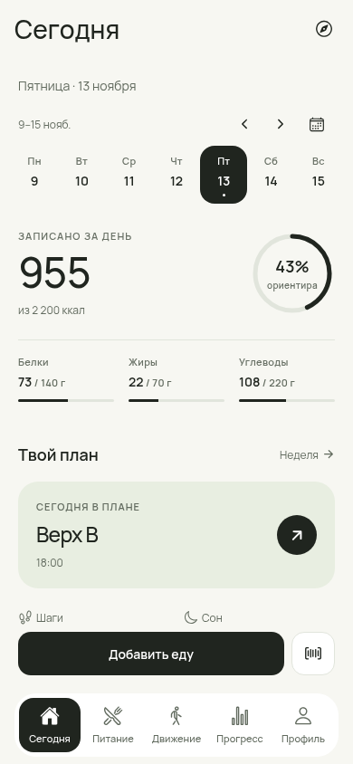
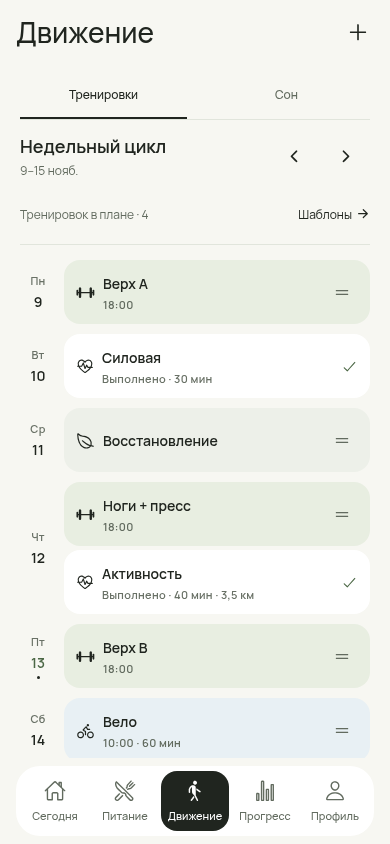
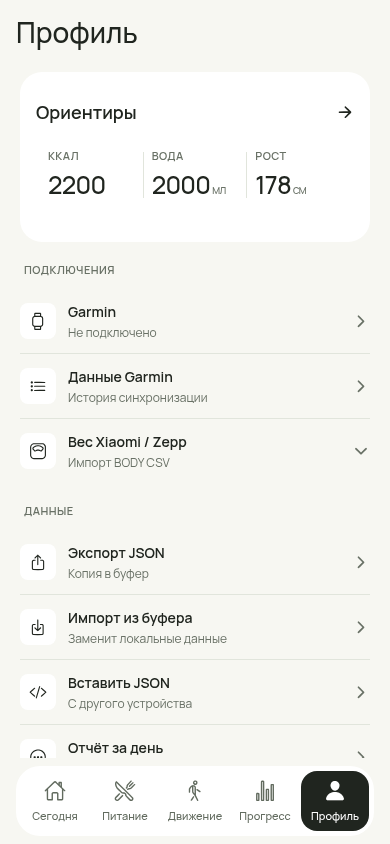
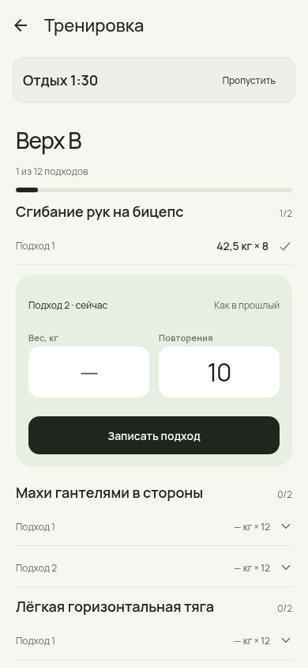

# Fresh Utility — implementation and evidence

Issue: #148. Branch: `feat/148-fresh-minimal-redesign`.
Base: `3c0d226` on main. Founder direction: full visual refresh, including substantial screen changes,13 November2026. This explicit request authorizes the design work despite the older generic redesign freeze; release and physical-device gates remain in effect.

## Changes

- One token contract, local licensed Manrope400/500/600, lighter headings and consistent existing text.
- A labeled floating dock occupying layout space; unified nested headers and sheets.
- Open calorie/macro summary, compact diary rows, smaller repeated actions and a useful training hero.
- Full weekly cycle with strength/cycling/rest cards and completed workout rows. Handle drag supports move, swap and same-day order exchange; menu move/copy/reorder remains available on Android. Undo restores the plan operation. Actual Garmin and completed strength history keep their source dates.
- Focused current strength set; completed and queued sets use compact rows.
- Profile goals are collapsed by default and directly editable via `?section=goals`. Existing exports, restore, privacy and integrations stay available.
- Planner and progress presentation aligned with the shared system. No storage migration, added app permission, backend or new package dependency.

## Verification

Final results: `npm run verify` passed with338 Node tests, root/mobile TypeScript and security scan. Android Metro export with `--no-bytecode` passed. Chromium checked25 route paths, the five main views at360/390/430px, food add/Undo/reload, real PanResponder drag/swap/Undo and decimal set recording/reload, without page or console errors. Details are recorded in `verification.json`. Do not infer Device Pass from these files.

Web evidence uses the bundled **synthetic** two-week fixture, shifted to the QA week, plus a synthetic strength/cycling plan. It contains no credentials or actual user health records.

Screens in `screens/` are captured from the running Expo application at390×844. They are implementation screenshots, not generated concept art.

## Android follow-up

Physical device: **not run**. Check touch/drag with multiple sessions per day, TalkBack menu fallback, large system text, keyboard and safe areas, set persistence after force-stop, food add/double tap/Undo, and five repeat-meal timings. Keep PERFORMANCE-BASELINE Device and Visual Audit Pass pending until the real run.

The cloud dependency install skips the ExecuTorch native-library download using `RNET_SKIP_DOWNLOAD=1` for TypeScript/web checks; the original downloader cannot reach its release host directly in this proxy environment. This does not prove a Gradle/APK build. A normal native build needs those existing libraries available.

## Risk and rollback

The font and primitive changes affect many routes together. Review the screenshots and the Android checks before merging. Reverting this PR restores the previous UI; no schema downgrade or data rewrite is required. The new swap operation uses existing planned-activity fields, with round-trip/history tests.

## Screenshots

