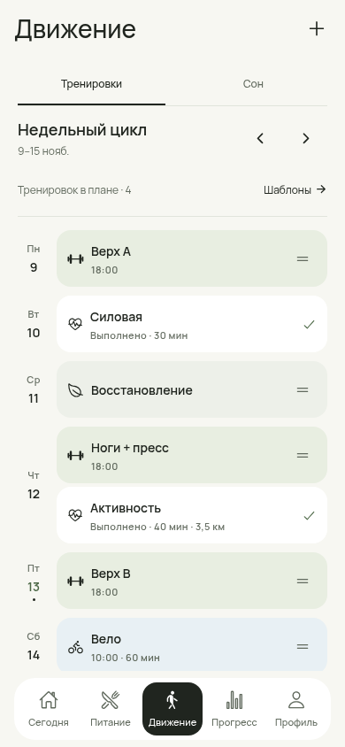
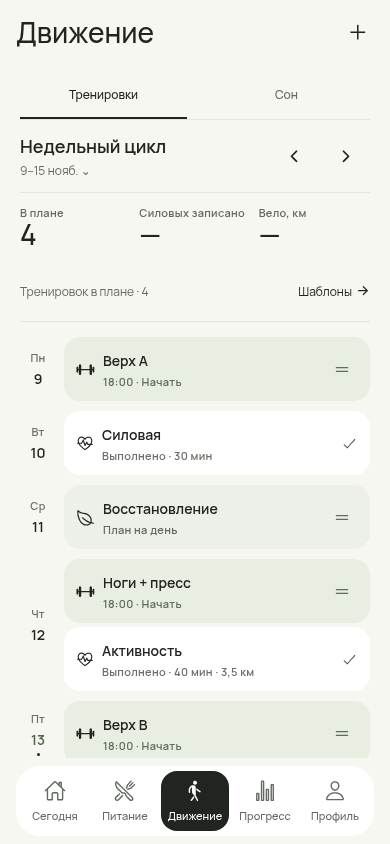
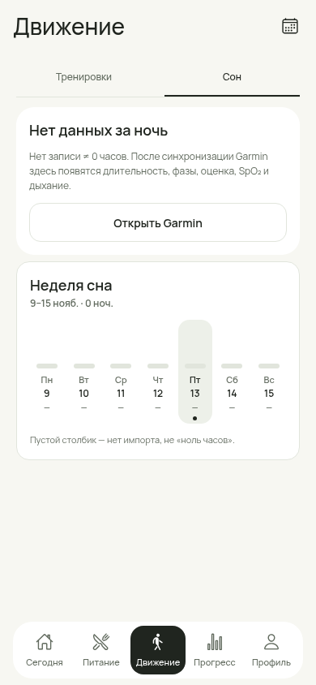
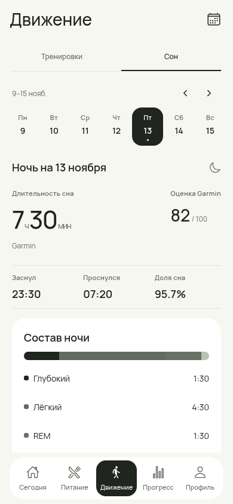
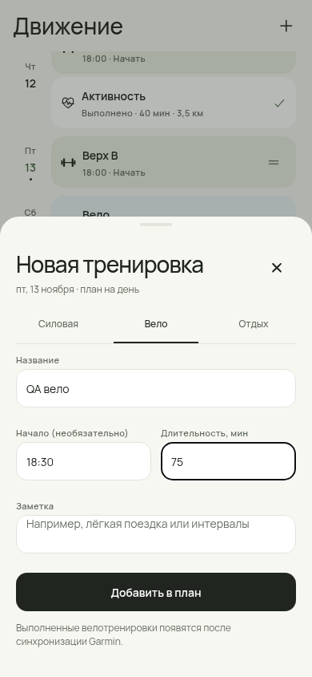
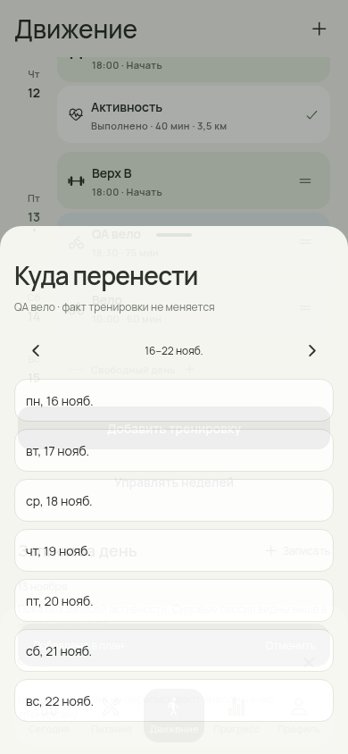
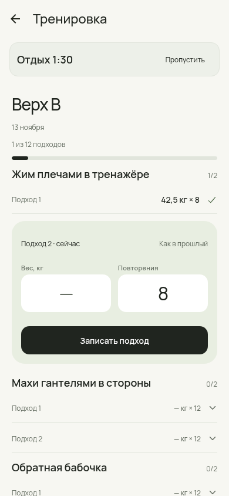
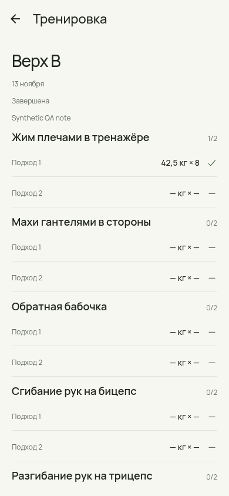
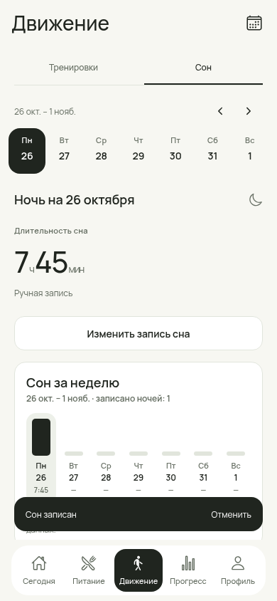

# Аудит приложения и доработка «Движения» — 13 ноября 2026

Issue #226. База: одобренный основателем редизайн из PR #225 (`0f47cf3`). Это следующий PR поверх его ветки; основной редизайн не сливался автоматически.

Проведён обзор продукта, UI/UX, доступности, доменной логики, сохранения, импорта/экспорта, интеграций, приватности, зависимостей и проверок. Метод: чтение кода, Node/TypeScript, npm audit и реальный Expo-web в Chromium. Это не пентест и не подтверждённый полный Android dogfood. Положительный отзыв основателя относится к предыдущему APK.

## Подтверждённые проблемы и исправления

| Приоритет | Было / доказательство | Исправление |
|---|---|---|
| P0, данные | `_layout.tsx` при исключении SQLite создавал пустой memory repository. Пользователь мог продолжить ввод без долговременного хранения. | Ошибка открытия блокирует ввод; повторное открытие доступно. Непрочитанный снимок не заменяется пустым. Проверяется и формат снимка. |
| P0, данные | Ошибка фонового persist выходила из Promise без сообщения о сохранности. Web storage проглатывал quota/write errors. | Репозиторий сообщает статус; постоянный баннер объясняет, что изменения пока в памяти, и даёт повторить запись. Состояние сохраняется в памяти для повтора. |
| P1, Android UX | Меню плана использовало более трёх Alert-кнопок. React Native Android обрезает список до трёх (`Alert.js`), поэтому часть действий недоступна. | Прокручиваемое меню: редактирование, перенос, копирование, порядок, шаблон, удаление с Undo. |
| P1, сессии | Повторное «Начать» создавало новые сессии и подходы. Завершённый план снова предлагал старт. | Повторный старт возвращает существующую сессию/результат. В цикле видны статусы и отдельные выполненные силовые. |
| P1, история | Незавершённые подходы закрытой сессии оставались редактируемыми; API не защищал историю. | Закрытая сессия доступна для просмотра; API отклоняет изменение подходов. Текущие записанные подходы можно исправить до завершения. |
| P1, порядок | Подходы сортировались по ID упражнения, а не по порядку шаблона. | Порядок создания сессии сохраняется при snapshot round-trip; фокус следующего подхода следует ему. |
| P1, таймер | Повторный отдых той же длительности мог не перезапуститься; секундные ticks отставали после background. | Deadline по реальным часам, пересчёт при AppState, восстановление оставшегося отдыха из времени последнего подхода. |
| P1, валидация | Изменение названия могло примениться до проверки неверной длительности; regex принимал 30 февраля; повторы могли быть дробными. | Предварительная проверка полей, настоящей даты, ЧЧ:ММ и целых повторов. Перенос добавляет карточку в конец целевого дня. |
| P1, планирование | Вело добавлялось сразу как фиксированные 30 минут; меню ограничивало перенос текущей неделей. Нажатие пустого дня использовало старую выбранную дату. | Редактор названия/начала/минут/заметки; явная дата новой карточки; выбор другой недели; повтор изменённого плана прошлой недели; Undo. |
| P1, сон | Мемоизированная неделя не зависела от revision. Одна известная фаза могла ошибочно стать общей длительностью ночи. | Сводка обновляется после записи/импорта; общий сон восстанавливается из фаз только при наличии всех трёх. Среднее исключает неизвестные ночи. |
| P1, приватность | SecureStore delete errors подавлялись, а wipe сообщал успех; ошибка сервера Garmin попадала в сообщения/снимок sync. | Обе операции удаления ключей выполняются, ошибка не скрывается. Wipe/отключение показывают неполное удаление; тела HTTP-ошибок не копируются в сообщения. Отмена не восстанавливает запись после wipe epoch. |
| P1, OCR | Legacy OCR вызывал неинициализированный ResourceFetcher; аналитика загрузок включена по умолчанию. | Загрузка через текущий публичный downloader с opt-out; legacy adapter принимает уже локальные файлы. Фотографии не отправляются. Реальное распознавание требует проверки на Android. |
| P1, зависимости | npm audit: 15 пакетов, включая 6 high. | Совместимые с заявленными диапазонами обновления lock-файла в SDK 57: осталось 6 пакетов (3 high, 3 moderate), 0 critical. См. ниже. |
| P2, завершение | «Без оценки» теряло введённую заметку; прерывание происходило без подтверждения. | Заметка сохраняется без RPE, видны числа записанных подходов; прерывание подтверждается. Кнопки RPE по 48dp. |

## Что изменилось визуально

Сохраняется Fresh Utility: Manrope, тёплый фон, спокойные поверхности, sage для силовых и голубой для велоплана. Добавлены сводка недели и статусы; меню и редактор используют общие токены. Сон показывает часы и минуты, время ночи, состав фаз, доступные показатели и недельное среднее. Полоса фаз показывает суммарный состав, не выдуманную хронологию. Ручная запись добавляет только длительность, без придуманной оценки и фаз.

Все изображения ниже — скриншоты работающего приложения на **синтетических** данных. Для примера Garmin-сна явно добавлена вымышленная ночь; реальных ключей и медицинских записей нет.

| До | После |
|---|---|
|  |  |
|  |  |

## Обзор остальных разделов

| Область | Результат и практический вывод |
|---|---|
| Сегодня / питание | Дневник, порции, null ≠ 0, undo и общий выбор дня сохраняются; существующие доменные regression tests проходят. Быстрота повторного ввода ≤10 секунд требует таймингов на телефоне. |
| Рецепты / план / покупки / бюджет | Основные маршруты открываются, горизонтального overflow на проверенных ширинах нет. По продукту остаётся избыточная глубина относительно быстрого дневника; без данных использования функции не удалялись. |
| Прогресс / отчёты | Маршруты проверены; HTML отчёта экранирует текст через `escapeHtml`. Силовые сессии и Garmin/manual Workouts — разные сущности; полная унификация общего подсчёта нагрузки требует отдельного решения о дедупликации. |
| Профиль / приватность | Импорт/экспорт и SQLite snapshot v19 сохраняются; миграций и новых разрешений нет. Микрофон явно заблокирован в Android-конфигурации: приложение работает с фото и штрихкодом. |
| Архитектура | Чистые расчёты отделены от UI; репозиторий остаётся большим. Полный снимок имеет стоимость O(размер данных) на запись. Исправлена видимость ошибок, нормализация SQL не переписывалась без измерений. |
| Доступность | Общие подписи действий, fallback переноса через меню, цели основных новых контролов 48dp, ошибки обозначены текстом. TalkBack, крупный системный шрифт и нативная клавиатура ещё не проверены. |
| Производительность | Проверены ширины 360/390/430 и отсутствие JS page errors в браузере. Это не измерения Android FPS, battery, cold start или force-stop durability. |
| CI / поставка | Сохраняется ручная standalone dogfood-сборка. Предыдущий APK успешно собран и установлен основателем; для новых изменений Android bundle экспортирован отдельно. Новый APK этим отчётом не объявляется готовым. |

## Проверка

- `RNET_SKIP_DOWNLOAD=1 npm run verify`: **348/348** тестов, root/mobile TypeScript, security scan. Skip относится к загрузке native libs при локальной установке, а не к тестам.
- 10 новых содержательных тестов: повторный старт, порядок после восстановления, неизменность закрытой истории, атомарность валидации, перенос/повтор недели, ручной сон, неполные фазы, retry сохранения, deadline и дробные повторы.
- Chromium: 21 основной/вложенный путь плюс сон и сессия; пять вкладок на 360/390/430. Создание велоплана → межнедельный перенос → Undo; ручной сон → обновление среднего → reload; подход → отдых → завершение без оценки с заметкой → readonly история; повреждённый JSON остаётся нетронутым.
- [Протокол браузера](browser-verification.json). Ошибок страницы нет.
- Android Metro export `--platform android --no-bytecode`: успешно. Это **не** APK/нативный запуск.

## Следующие работы — открытые ограничения

1. **P1 security:** `decode-uri-component → query-string → expo-router` (3 high как цепочка зависимостей) и `minimatch → @expo/fingerprint → expo` (3 moderate). Рекомендуемые npm исправления требуют смены major Expo/Router, вплоть до несовместимого отката SDK. `--force` не применялся. Нужен отдельный совместимый SDK-upgrade с проверкой deeplinks и native build. [Точный npm audit](dependency-audit.json).
2. **P1 Android:** force-stop после записи еды/подхода/сна, drag с автопрокруткой, TalkBack, клавиатура и крупный шрифт; реальный Garmin sync, OCR, SecureStore failure и окончательный manifest. Device/Performance Pass остаются pending.
3. **P1 продукт:** явно связывать велоплан с выбранной выполненной Garmin-тренировкой, а не угадывать по дате. Сейчас обе записи честно показаны отдельно.
4. **P2 цикл:** повтор прошлой недели и базовая личная программа работают; отдельный редактор постоянного шаблона всей недели и автоматическое расписание на будущие недели пока не добавлены.
5. **P2 данные/скорость:** замерить размер/время snapshot на устройстве, затем решить необходимость отдельных SQL-сущностей и защищённого recovery-export повреждённой базы.

Откат: revert этого PR возвращает предыдущий интерфейс и поведение; snapshot остаётся v19. Ручные ночи используют уже существующий `source: user`. Закрытые сессии больше нельзя менять через API подходов — это намеренная защита истории, а не удаление записей.
