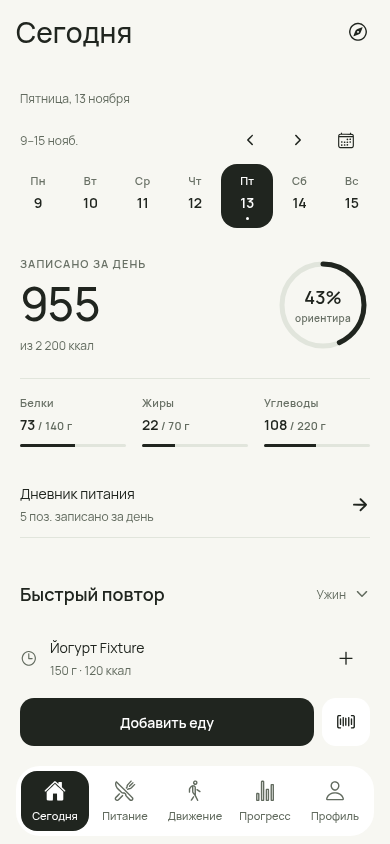
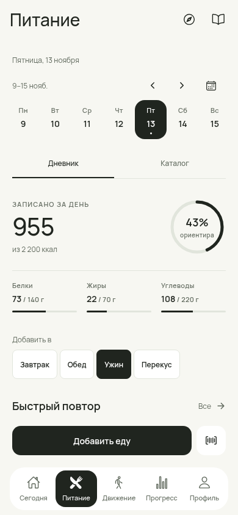
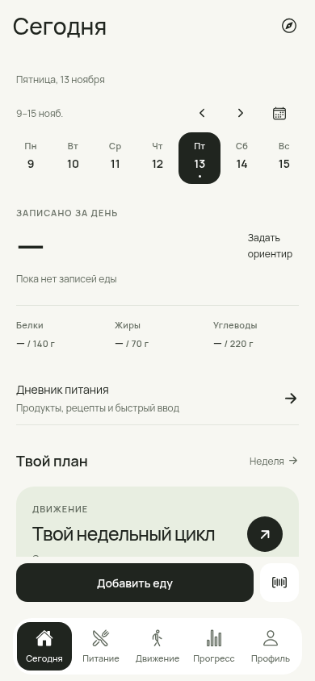
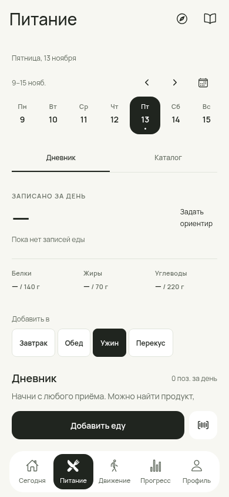
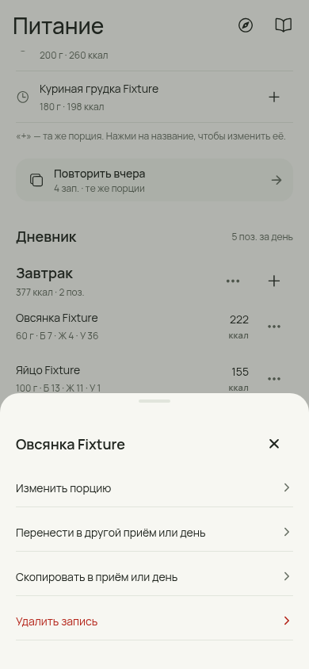
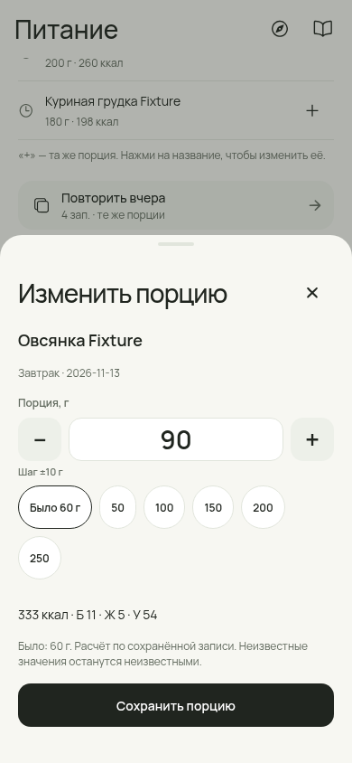
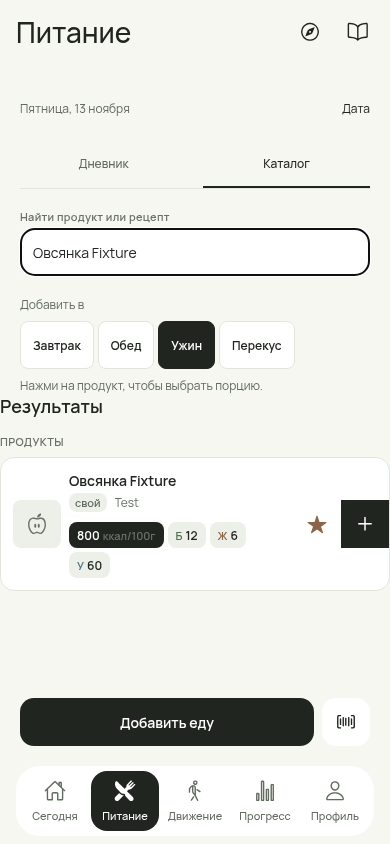
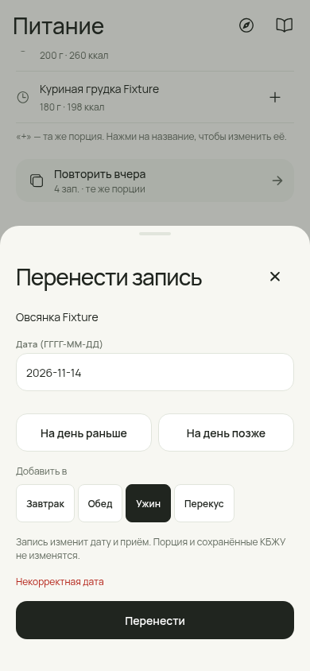
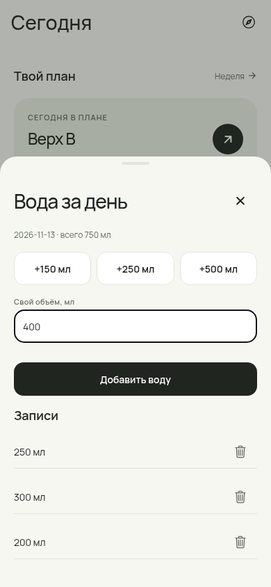
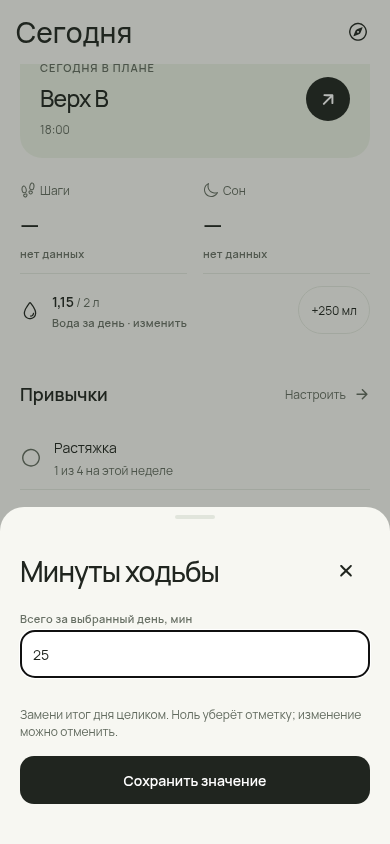

# «Сегодня» и «Питание» — полный проход

Отчёт: **14 ноября 2026**, issue #230. База — PR #229 (`cc16e82`), отдельная ветка `feat/230-today-food`. По запросу основателя доработаны оба раздела и связанные сценарии ввода. Дизайн сохраняет Fresh Utility: Manrope, спокойный светлый фон, ясная типографика, общие кнопки и поля.

## Что изменилось

| Область | Было | Теперь |
|---|---|---|
| Сегодня | Сводка дня, но повтор еды — через другой раздел; привычки могли не обновиться сразу | Сводка → ссылка на дневник → компактный быстрый повтор с явным приёмом → тренировка → вода/сон/шаги → привычки |
| Дневник | Повтор находился после четырёх приёмов; действия строки скрыты в свайпе | Повтор перед дневником; четыре понятных приёма; у каждой записи видимое меню |
| Запись еды | Граммы могли пересчитаться по уже изменённой карточке продукта | Изменение массы масштабирует **сохранённые** КБЖУ. Каталог и прошлые записи не переписываются |
| Быстрый ввод | Абсолютные калории отображались как граммы, повтор был недоступен | Понятные порции; повтор и изменение количества порций, неизвестные БЖУ остаются неизвестными |
| Повтор вчера/приёма | Зависимость от существования продукта/рецепта; часть записей пропускалась | Повтор сохранённых снимков, включая Quick Add и записи без доступной карточки; вся группа проверяется до записи |
| Шаблоны приёмов | Удалённый ингредиент мог незаметно пропуститься | Шаблон добавляется полностью либо сообщает ошибку. Используется выбранный пользователем приём, а не скрытый default |
| Действия записи | Нет явного переноса в другой приём/день | Изменить порцию, перенести, скопировать, удалить; везде обратная связь и Undo |
| Вода | Только +250мл | Быстрое добавление с Undo, собственный объём, список записей, удаление/восстановление |
| Привычки | Количественная привычка работала как checkbox; мемоизация могла устареть | Checkbox обновляется сразу; количественная привычка принимает итог дня и пересчитывает неделю; изменение можно отменить |
| Каталог | Полная шапка календаря уменьшала область результатов | Компактная дата, явный приём, поиск, полные подписи фильтров; последняя порция продукта используется при добавлении |
| Пустые/неполные данные | Ноль мог выглядеть как измеренный итог отсутствующего дневника | Пустой день — «—» и понятная подпись. Неполные КБЖУ отмечены; проценты не показываются как измерение при отсутствии записей |

## Проверенные исправления

- **Исторические данные.** Если овсянка была записана как222ккал/60г, а её карточка затем изменилась на800ккал/100г, изменение старой порции до90г даёт333ккал. Новое добавление из каталога использует текущие800ккал/100г. Undo возвращает исходную запись точно.
- **Повтор.** Копируются порция, название, источник и снимок КБЖУ. Неизвестное не заменяется нулём. Ошибка одной исходной записи не оставляет половину повторённого приёма.
- **Перенос.** Проверяется настоящая календарная дата; 30февраля не сохраняется. При исправлении поля сообщение об ошибке убирается. Undo возвращает запись и выбранный день к исходному состоянию.
- **Защита от двойного тапа.** Guard общий для путей добавления, а не отдельный у каждой кнопки. Уведомление Undo не принимает случайный второй тап первые500мс, когда оно могло появиться под пальцем. После паузы тот же продукт можно добавить снова.
- **Undo.** Один таймер в DataProvider —8секунд; скрытая вкладка не может погасить новое уведомление своим старым таймером. Ошибки отмены показываются. После wipe или восстановления снимка старое Undo недоступно.
- **Остатки приготовленного.** Undo нового добавления рецепта возвращает фактически списанные граммы в ту же партию; повторная отмена не увеличивает остаток ещё раз. Журнал этой кратковременной отмены не сериализуется: после перезапуска самой кнопки Undo тоже нет.
- **Пустая масса.** Очистка поля граммов не подставляет прежнюю порцию при сохранении. Ввод остаётся невалидным, запись не создаётся, ошибка видна в форме.
- **Контекст ввода.** В добавлении и подтверждении видны дата и приём. Выбор порции и быстрый повтор используют общую дату/приём между вкладками. Сканер, открытый из добавления, закрывает родительский sheet после успешной записи; отдельный сканер сохраняет возможность сканировать дальше.
- **Восстановление данных.** После импорта обновляются все разделы, а не только профиль; прежний Undo сбрасывается. Новая мемоизация каталога не оставляет старые продукты на экране после восстановления.
- **Доступность.** Явные ARIA-состояния выбранных вкладок/дней, нажатых чипов и checkbox дополняют native accessibilityState. Основные действия —48dp; меню доступно без свайпа.

Шаблон «Мой приём» сохраняет продукты и рецепты. Если в исходном приёме есть Quick Add, диалог заранее объясняет, что он останется в дневнике и не войдёт в шаблон. Для повторения всей фактической еды, включая Quick Add, есть «Повторить этот приём» и «Повторить предыдущий день».

## Скриншоты работающего приложения

Синтетические данные; в браузере закреплён тестовый день **13 ноября2026**. Это не личные записи и не Android Device Pass.

| Сегодня | Питание |
|---|---|
|  |  |

| Пустой день | Пустой дневник |
|---|---|
|  |  |

| Меню записи | Изменение порции |
|---|---|
|  |  |

| Каталог и поиск | Перенос между приёмами/днями |
|---|---|
|  |  |

| Вода | Количественная привычка |
|---|---|
|  |  |

Остальная галерея: [каталог](screens/catalog-final.png), [ничего не найдено](screens/catalog-empty-search.png), [дневник с неизвестными БЖУ](screens/food-unknown.png), [обновлённая сводка](screens/today-final.png), [неполные итоги](screens/food-final.png), [Quick Add](screens/quick-add.png), [повтор порций](screens/repeat-quick-portions.png), [пустые граммы](screens/invalid-portion.png), [ошибка шаблона](screens/saved-meal-error.png), [ручной продукт](screens/manual-product.png), [длинное имя — Сегодня](screens/today-long-name-360.png), [длинное имя — Питание](screens/food-long-name-360.png).

## Проверка

- `RNET_SKIP_DOWNLOAD=1 npm run verify`: **362/362**, root/mobile TypeScript, security scan и проверка совместимости зависимостей. Skip относится только к локальному скачиванию native libraries при установке.
- **10 новых доменных сценариев:** исторический snapshot и Undo; атомарный повтор с Quick Add; валидация переноса; отказ от частичного шаблона; вода; абсолютный итог привычки; нулевая исходная масса/unknown; удалённый рецепт; невалидная дата/переполнение; точная идемпотентная отмена списания приготовленного.
- Изменены устаревшие проверки, требовавшие пересчитывать историю по новому каталогу и держать повтор ниже приёмов. Новое поведение проверено доменными и браузерными сценариями; ограничения exact-copy/source-order больше не задают продуктовый порядок.
- Chromium: обе вкладки и каталог на **360/390/430**, empty/filled/unknown, длинное имя на360, ручной продукт, порция, Quick Add, двойной тап, вода/привычки, перенос/копирование/удаление, избранное, прошлый день, ошибки, reload, повтор без сети. JS page errors отсутствуют. [Основной протокол](browser-verification.json), [дополнительные сценарии](browser-extra-verification.json), [длинные имена и ручной ввод](browser-complete-verification.json).
- Android Metro export `--platform android --no-bytecode`: проверка JS/module graph. Это не новая APK-сборка и не запуск на физическом телефоне.

## Изменённые части и совместимость

Вкладки `app/(tabs)/index.tsx` и `food.tsx`; общий дневник/ввод (`FoodQuickStrips`, `MealSection`, `AddFoodSheet`, `ConfirmPortionSheet`, `PortionStepper`, подтверждение порций, перенос, вода и привычки); `DataContext`, общий feedback/Undo и ARIA-состояния; доменные операции `diaryEntry.ts` и repository. В профиле исправлена инвалидация Undo и обновление вкладок после импорта. Неиспользуемый старый PortionEditModal удалён, сохранён один редактор фактической порции.

Snapshot остаётся **v20**, SQL schema не меняется, новых зависимостей/разрешений/backend нет. Откат этого PR — revert к #229: данные остаются читаемыми. Уже созданные записи и их сохранённые КБЖУ не пересчитываются автоматически.

Физические Android-проверки ещё нужны: force-stop после записи, работа клавиатуры, TalkBack/крупный системный шрифт, камера и реальный barcode/OCR. Скорость повтора ≤10секунд на телефоне не объявляется измеренной. Для отдельной задачи остаётся согласование исторического редактирования/удаления рецепта с остатками партий: здесь исправлен именно Undo нового добавления, без догадок о прошлых партиях и физически съеденной еде.
